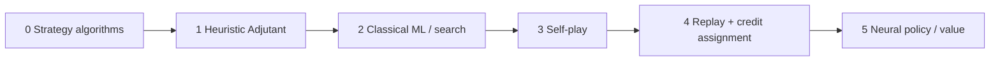

# Adjutant evolution — from strategies to learned opponent

Status: **CURRENT LOCAL RESTORATION / R3 SOURCE AND BOUNDED VERIFICATION COMPLETE: ALL FINAL LOCAL CHECKS PASS, BOTH CLOSING REVIEWS READY. FOUR MEANINGFUL COMMITS THROUGH3b29e73a EXIST ON ORIGINAL FORK997141; THREE REMOTE BACKUPS VERIFIED. FIFTH VERIFICATION-DOC COMMIT AND PR47 LEASE PUSH PENDING; REMOTE FEATURE STILL46c. R4 RAW8 ARCHIVE-ONLY, FUTURE FULL R4 BLOCKED/UNIMPLEMENTED; GLOBAL R5 NOT READY, NOT TRAINING-READY.** No new Docker assurance, model data/calibration/training, learned artifact, HIGH waiver or frozen amendment. [Current final lifecycle](_spec/_plans/recovery-pr47.md#final-local-restoration-complete-publication-pending).
Scope: how Single Player’s opponent (`packages/starchess-core/src/ai/adjutant.ts`) grows from named strategy algorithms → a composed heuristic → something that learns, without rewriting the StarChess rules engine.

**R3 authority and current proof:** actual **“Accept + build locally (Recommended)”** and its [exact targets](_spec/_plans/ml-adjutant-r3-seam-addendum.md#executor-acceptance-and-scoped-local-build-authority) remain accepted. Earlier REC proof stays by revision; the [final latest-source proof](_spec/_plans/recovery-pr47.md#final-local-restoration-complete-publication-pending) now closes current restored R3/local assurance without borrowing2359 or partial gates. This is no global R5 Docker/calibration/learning closure.
**Current recovery authority:** actual Restore ALL/backup/**“Rewrite + lease (Recommended)”**/**“Archive unfinished R4 (Recommended)”** decisions govern this restoration. Four existing commits are9054fae6 catalog/UI, a030c3e6 bounded ML/authorized economics, c2ec73cf frozen assurance/recovery and3b29e73a erasable-consumer/strict typing fixes. Lead verified published46c, recovered0388 and combined7519 backup refs; original three-commit tree `6f82d439fd11095acd788fa61a1c4d12b8ecf121` equals combined7519 before the consumer fix. Isolated docs writes occur only in `/tmp/opencode/chess-coach-pr47-rewrite`; PRIMARY code passed current checks but is not written by keeper. Original fork997141 remains the history base, not origin/main2c749 Tutorial Revision48. The last verified remote feature remains46c; approved lease publication is still pending.

**Final actual verification:** root CI typechecks7 projects and whole strict core+arena+two-script invoice PASS; full core554/62 files, training95/6 files, arena2382/36 files/1364.07s with0 failed/pending/todo/skipped, Node109/0skip, UI34/4 files and CSS layout PASS. Fresh non-learned54 matches+54 reruns have integrity/performed/equal/migrationParity true. Current inventory166/12/956 SHAeed106…51cc4 matches actual baseline pins; public5 roots/38 paths and all9 checkonly/SVG PASS. Lead preservation checks pass88 history/corpus,21 published payloads,8 raw R4,4 protected bodies, UI owner/index and orrery. Both current closing reviews READY. [Final proof/test-owner table](_spec/_plans/recovery-pr47.md#final-local-restoration-complete-publication-pending) records exact hashes/methods and retained initial TS1294/strict failures; keeper executes nothing.

**Publication handoff — not complete:** four meaningful source/history commits already exist and the verified latest-source local gate is complete. Lead reviews this mutable record, then may create fifth `docs(verification): record PR47 restoration results` and perform the explicit46c-expectation lease push. The fifth ID is not invented or embedded into its own content. Keep all three backups and unrelated material; do not claim PR/origin updated until actual remote/API evidence exists. Observed local b497 auto-persist naming was reworded to3b29 under Executor's explicit amend request, without runtime change; no earlier autosync-failure cause is inferred.

The preparatory catalog is implemented and verified separately from this learning roadmap;
the verification record includes the existing full-app lint baseline exception:
[`adjutant-definitions.puml`](_spec/packages/starchess-core/adjutant-definitions.puml),
[`menu-flow.puml`](_spec/apps/starchess/menu-flow.puml), and
[`PLAN-ml-adjutant.md`](_spec/_plans/PLAN-ml-adjutant.md).
The registry ID is `machine-learning`; `ml/` names proposed training tooling, not an opponent alias.
`machine-learning`, `rlhf`, and `rlcd` remain EMPTY and unavailable until implemented.
The implemented catalog definitions do not complete any learning stage below.

## Historical R0 foundation — closed then, not current proof

The authoritative [strict ML roadmap](_spec/_plans/PLAN-ml-adjutant.md) records **A01–A15 CLOSED** within accepted non-learned execution/evidence assurance.
Use unchanged [R0 closure JSON](_spec/evidence/ml-adjutant-r0-closure.json) and [historical frozen verification](_spec/evidence/ml-adjutant-r0-refresh/verification.json) for original R0 facts and pins only.
Historical final post-publication adversarial `ses_efe0ed67dffew2su1gZIUaDy23` and security `ses_efe0ed520ffeOEg3kd6jAtN33i` both returned **READY TO CLOSE R0: yes**.
Recorded historical checks: **689/689 arena + 426/426 core**, zero failed/pending/todo; **54 executions + 54 semantic reruns**, parity true; **107 Node tests**, **5/5 actual Docker infrastructure**, and **13/13 host post-publication checks**, no skips.
Those historical host checks included both then-live source pins; all **8 exact verification commands**, including three static checks and both scripts, passed then.
The [original closure/pin record](_spec/_plans/PLAN-ml-adjutant.md#r0-closure--current-frozen-evidence) retains its legacy navigation anchor; none of its pins proves the recovered R2 tree.
This closes assurance, not learning: weights remain **NONE**, no trained artifact or learned acceptance exists, and `machine-learning` stays unavailable.
Lead historically reported both then-updated diagrams passed PlantUML `checkonly` with exit **0** and `git diff --check` passed; this pass reruns neither check.

### Current R2 — CLOSED bounded V3/authorized V1 assurance, not learning

The closure below describes the preserved original R2 generation, not new Docker assurance. Current restored R2/R3 source has separate completed bounded local verification in the final recovery record; no old image/count is relabeled as that new source's hermetic proof.

Authority: unchanged [R2 closure JSON](_spec/evidence/ml-adjutant-r2-closure.json), **outside** immutable [57-artifact published evidence](_spec/evidence/ml-adjutant-r2-refresh/verification.json). The complete **new generation** passed all11 frozen commands, core475/arena1944/training57/Node109, four static checks and actual Docker infrastructure6, with zero fail/skip/pending/todo. **54+54 semantic reruns equal** and original pin-migration parity preserve native baseline behavior.
Host importer again independently validated exactly eight inputs, current source/public graph/composition/coverage, ordered archive layers/official Node bytes and dependency/infrastructure/control bindings (`ok`), then published **exclusively, committed/durability confirmed**. Lead reports post-publication current-pin/coverage14 PASS, validated published57 map and tool-recomputed hashes; spec-keeper reruns none.

| Final POST-PUBLICATION review | Recorded verdict/session |
|---|---|
| Adversarial | **READY TO CLOSE R2: yes** · `ses_ef1bd904effeNnwLrxzq5IFMTc` |
| Security | **READY TO CLOSE R2: yes** · `ses_ef292c512ffeiNMZ7KVQloY4sj` |

Both reviewed persisted source/evidence read-only, not independent suite/archive-hash reruns. These closing verdicts supersede earlier scoped approvals/pending gates without borrowing failed commands.
Recorded marker SHA-256 is **`65bc6bb200514b446ad6939412922bde1cfa00d76225495e309fbd165c81b0c3`**. Exact source/dependency/source-control/archive identities are in the closure JSON and [closed R2 contract](_spec/_plans/r2-generator-v3.md#current-r2-closure--completed-new-generation); external archive **134552576 bytes** stays outside57 payloads, its export envelope is retained inside them.
The historical R2 assurance retains authorized V1/bounded512/2048/four-slot V3 and its four-root generation in the [assurance owner](_spec/packages/starchess-arena/ml-adjutant-policy-contracts.puml). The current [generator owner](_spec/packages/starchess-training/candidate-generation.puml) additionally documents R3's counted V2-history entry and fifth pure `/events` root. Host-private admission, no fallback/hidden-state inputs and unchanged costs/codecs/grammar/permits/resources remain invariants; bounded omissions are not exhaustive legality or wins.
Native baseline remains **corpus0 wins/2 losses/16 queue rejections; live0 wins/36 losses**. Supported source audits do not prove arbitrary-JS purity, and hashes prove byte identity rather than producer authenticity. `modelArtifact:null`, eligiblefalse/learnedPassfalse/trainingfalse; weights NONE, `machine-learning` disabled, no learned acceptance/registry activation.
R2 is closed and amended R1 design CLOSED/FROZEN. R3 ledger/provenance/count transport is locally verified; **R4 belief/features +global R5 hermetic/calibration/readiness** remain before explicit **R6**. R7 artifact/runtime precedes R8 learned acceptance; frozen profiles remain unchanged outside accepted R3 precedence.
No source, hermetic README, tests/packages/controls or immutable57 payloads/marker/outside-bundle closure record changed here. Lead validates diagrams once after final docs; no renderer/test/hash execution by spec-keeper. Caller owns the final Upgrade Complete outcome.

<details>
<summary>Superseded R2 operating checkpoints — history only</summary>

All failed/pending statements below belong to earlier checkpoints, **not current R2 status**. They remain operating history with private tmp reports, not accepted pins; complete new generation above supersedes them without stitching partial successes.

Specs record **R2 WIP / latest frozen retry2fae1… FAILED:1942 PASS/2 timeout FAIL/0 skipped**. Scoped reviews and byte-equivalent test optimization do not prove constrained timing. Exactly four finite framework240000ms allowances are approved; new source capture/all-eleven verification and closing gates remain pending.
The [approved R2 V1 bridge / V3 amendment](_spec/_plans/r2-generator-v3.md) and [candidate-generation.puml](_spec/packages/starchess-training/candidate-generation.puml) own the current scoped work.
Executor reports recovered R2 source; archived legacy R0 logs and temporary images are missing.
Require bounded detached DTO inspection (depth **16**, **8192** root/node/edge visits, **1 MiB** total UTF-8 strings/keys), memoized shared subtrees with path-depth checks, cycles/accessors rejection, and frozen `ACTION_KINDS`.
Executor's TUI-approved **Freeze native tables** direction freezes `UNIT_COST`, `SPECIAL_REGISTRY` and every nested special entry at declaration; authoritative costs and native admission/grammar remain unchanged.
Executor approved exact core `{'.':'./src/index.ts','./planning-v1':'./src/planning-v1.ts'}`; arena stays `['.','./observations','./intent-codec-v1']`, training stays `['./candidates']`.
Every conditional workspace export branch, including node/default/unselected branches, must use its canonical approved target, not merely satisfy keys or browser resolution.
The four model audit roots are **core `/planning-v1`**, **arena `/observations` + `/intent-codec-v1`**, and **training `/candidates`**; authorized/model runtime + type imports retarget there with direct deep-core exceptions removed. Full native core `.` / `coreRoot` and arena root remain **host-only, captured and inventoried**; `fflate` remains a core host dependency, not public model closure.
Executor approved exact **`jssha`3.3.2**, import **`jssha/sha256`**, **BSD-3-Clause**, synchronous SHA-256 → **Uint8Array32**, explicitly overriding historical Noble2.4. No vendor constructor exception, patch or tree-shaking assumption is approved. Official release/LICENSE research links and the **independent audit not located** disclosure live in the [R2 amendment](_spec/_plans/r2-generator-v3.md); do not claim independently audited.
Authorized/model closures use static ESM only and reject literal runtime dynamic imports and computed callable-member constructor bypasses hidden by `any`, aliases or wrappers, including numeric arrays and nested/destructured origins; ordinary data-array indexing and reviewed DTO descriptors remain valid.
Implemented factory/member-mutation guards preserve numeric/literal-bounded data indexing and type-checked ordinary maps, but reject callable or unproven computed receivers. The lazy `dataType` program uses a separate AST from lexical bindings and sets `resolvedUsingTsExtension:false` for workspace inference without granting runtime-loader permission.
Fresh eleven-command verification requires a separate mandatory actual Docker infrastructure envelope tied to the captured dependency image and independently joined by the importer.
Infrastructure retains **six ordered identities (five static + actual Docker)** and independent probe binding. The older pre-Env rejected capture remains history; Executor now reports later dependency987a49…/source757266… builds and actual6 envelope capture **Hevj/HejvG7 PASS**. Prefixes/labels are not new full pins. That source generation failed later; new actual recapture remains required for retry.
Executor TUI-approved **unique valid key/value equality** permits Docker to reorder source/probe initial/final container Env. Shared `policy.sameEnvironment` requires independently measured image defaults plus **only HERMETIC_OUTPUT_DIRECTORY**, rejecting duplicate keys, bare/malformed definitions, missing/extra keys, changed values and NODE/LD preloads. Retain original vectors; immutable image **Config.Env order stays exactly bound**, not normalized.
Dependency-image claims bind exact **Id/Os/Architecture/Variant/Config/RootFS** against independent inspection, excluding mutable tags/repository digests/daemon storage metadata; legitimate tagging is accepted without allowing changed configuration/layers or rewriting retained full inspections.
Its child receives only fixed PATH, private HOME, fresh empty private DOCKER_CONFIG and immutable image identity; exact recorded-env checks reject inherited preload/Docker endpoint/credential overrides.
Host-owned canonical `/tmp/opencode` may remain **0700**; public-output negative fixtures do not require that private parent to become public.
Importer requires **`--acquisition`** from **`build --dependencies --no-cache`**, independently joined to dependency-image measurements/controls/input invoice, exact argv and successful untruncated logs; retain acquisition/build/execution/export envelopes plus all declared logs in the published host-provenance namespace.
Generated capture/workspace files explicitly chmod **0644**, and captured child directories **0755**, under umask **077**, without widening the private scratch root.
Both source-container inspections must match the runtime entrypoint, `Cmd=['verify']`, cwd `/app` and unique Env definitions equal independent image defaults + sole output; reject interpreter/linker preloads and bind attachment to the same inspected container.
Floors remain **v3 475/1944/57**, all assertions retained. Earlier temporary `yuYpvM` records1703 PASS/2 timeout FAIL/239 hook-skipped; keep those failure bytes/history unchanged. Subsequent **two-CPU retry d2fb…** reportedly passed commands1–7 again (54+54/all four static/core475), then command8 **1943 PASS/1 timeout FAIL/0 skipped**. All239 formerly blocked tests executed; commands9–11 **not run**. Both generations FAILED; neither partial identifier nor temporary path is an accepted pin/publication.
Latest operating attempt **2fae1…** reportedly passed commands1–7, then arena8 **1942 PASS/2 timeout FAIL/0 skips**; all239 previously blocked tests again executed and9–11 were not run. Keep every generation's failure counts/reports separate; all partial labels/private tmp artifacts are operating metadata, not persisted pins or accepted source images.
Executor reports **source-inventory1177 full PASS** (prior913 +264). Alias/member/caller mutation effects reach a source-bounded fixed point; candidate flow conservatively retains destructuring assignment targets, object-held functions, defaults/rest and sparse callee identities. Pristine Array/iterator and actual-type/per-module callback guards remain, without arbitrary-JavaScript proof.
**Both scoped final source-freeze reviews YES**, as reported by Executor: adversarial **`ses_ef1bd904effeNnwLrxzq5IFMTc`**; security **`ses_ef292c512ffeiNMZ7KVQloY4sj`**. The current step is **source-freeze eligible**, with final enumeration/static/PlantUML pending; these are not Docker-completion or post-publication closing verdicts and authorize no training.
Executor reports **both contained Env-delta reviews YES** in the same sessions, plus **75 focused tests PASS**, **30 added assertions**, **three JS syntax checks/all strict/arena-types/diff PASS**. Scope stays contained; no formal JavaScript purity, accepted current infrastructure envelope or all-new full closure is claimed.
Earlier attributed **public-v2 PASS** four roots/28 workspace/two jsSHA files/zero external runtime imports, **training57**, **core475**, all three typechecks/whole strict/Node109 remain checkpoint facts. Independent SHA padding/Unicode/subarray/collision, native identity, ownproto/packed preservation and ordinary prototypes passed then; no vendor exceptions, patch or tree shaking. This pass runs no checks and claims no full1944/new-control frozen proof.
Private native/host side/bank/table reads now use own `Object.entries(...).find`, preserving all valid native values. Whole-queue native `addScAction` admission and `commitPair` retain original stage intent/resource/gas/spend checks; no fallback or new model access is introduced.
Read-only architect **`ses_ef028270`** proposed **TUI-approved scoped Vitest allowances only**: import diagnostic `beforeAll` **240000ms**, fresh-pin suite test **180000ms**, coverage/pin reproduction test **180000ms**. Those scopes remain implemented; no completed passing frozen generation is proven. Immutable snapshots/fresh validators, other assertions/budgets/floors/permits and2CPU/4GiB/network-none remain unchanged; no caches/filters/global override.
Earlier positive publication logical checks took148219ms against the then120000ms budget. Native `Buffer.equals`/one validated bundle read preserve exact bytes, missing-artifact rejection and marker/provenance assertions, **not a timing guarantee**. No cache or dropped assertion was introduced; that optimization's host positive1 PASS remains historical, not frozen completion.
Executor reports **scoped security/adversarial equivalence YES**, latest host positive1/types/whole strict/diff PASS, not a fresh frozen PASS. No new review IDs or full image hashes are invented. R2 completion/publication marker remains absent; preserve old failures and never stitch their passing command fragments.
Executor TUI-approved **240000ms ONLY for four complete-validation/publication tests**, from120000ms: successful publication, competitor preservation, before-publication hook failure, postcommit snapshot-cleanup failure. Source confirms all four; earlier hook240000/pin180000/coverage180000 scopes remain. Independent child-validator120000ms/safety caps and model planning/startup/match/Node/production budgets stay fixed, as do2CPU/4GiB/network-none and floors475/1944/57. No global timeout/cache/filter/removed assertions; no proven fresh PASS.
Next allowance-bearing source capture/image and actual6 infrastructure remeasurement/capture must validate the same measured dependency987a49/current acquisition and unchanged controls/lock/manifests before **all eleven commands from1**. Drift stops reuse/escalates; no forced network acquisition when all joins match. No failed source images or successful command fragments count as acceptance. No source or hermetic README edits here, so this docs pass changes no captured controls.
Older rejected pre-Env records stay unusable; all frozen failure records remain separate. Hermetic README remains untouched to avoid control drift. Follow the [R2 checklist](_spec/_plans/r2-generator-v3.md#83-r2-acceptance-checklist--completed-bounded-assurance) for all11/54+54/archive/export/import/publication/post-publication reviews—all pending at this historical checkpoint. Lead validates both diagrams once after final documentation writes; no renderer runs here.
Executor approved restoring **ONLY `_spec/evidence` mode0700**, preserving historical file bytes, for the local publisher **after verification**; publish exclusively into a new R2 namespace, never overwrite history. Approval is not chmod/publication execution; neither occurs here. R2 remains WIP, not complete or training-authorized.
The [R2 provenance contract](_spec/_plans/r2-generator-v3.md#72-fresh-acquisition-offline-source-build-and-durable-host-provenance) owns exact acquisition/source vectors, environments, log metadata and retention.
No accepted images from failed generations, R2 completion, training, weights or registry activation is claimed. Acquisition/infra and seven-command successes do not close a failed generation; archive/import/local-exclusive publication after checks and final reviews remain pending.

</details>

### Historical Phase 1 verification

The separate strict-challenge roadmap now owns Phase 1 in `packages/starchess-arena`:
[`ml-adjutant-challenge-harness.puml`](_spec/packages/starchess-arena/ml-adjutant-challenge-harness.puml).
Phase 1 is IMPLEMENTED; the following records its historical verification, not the current R0 generation.
The lead historically reported adversarial and security reviews READY: yes for the trusted non-learned scope.
Then-final arena verification passed 164 tests / 17 files after all source/test changes, arena
typecheck, and the strict test TypeScript check; that core run passed 426 tests / 53 files with typecheck passed.
Historical evidence:
[`baseline-report.json`](_spec/evidence/ml-adjutant-phase1/baseline-report.json) and
[`verification.json`](_spec/evidence/ml-adjutant-phase1/verification.json).
All 54 historical semantic reruns matched; candidate wins remain 0/18 corpus and 0/36 live strategic.
This completes the non-learned harness baseline, not learned acceptance.
Both renamed diagrams and the edited spec map historically passed PlantUML `checkonly`.
Historical Phase 2 hermetic verification PASSED in arena; its records remain below. This is not a learned PASS.
Current policy/assurance boundary:
[`ml-adjutant-policy-contracts.puml`](_spec/packages/starchess-arena/ml-adjutant-policy-contracts.puml).

### First-training prerequisites — still pending

The independent delayed-swap native mine synchronization is implemented under Executor's **“Apply Native sync-fix proposal”**, with verification/review progress in the [scoped execution record](_spec/_plans/ml-adjutant-r3-seam-addendum.md#independent-native-delayed-swap-synchronization) and [resolver diagram](_spec/packages/starchess-core/resolve-turn-activity.puml).

The [earlier R3 local proof](_spec/_plans/ml-adjutant-r3-seam-addendum.md#completed-recovered-local-verification--bounded-r3-only) remains successful by revision. Active R3 and the independent mine fix now have actual current554/95/2382/full strict/CI7/54+54/audit/render/closing-review proof in the final record. Local restoration is complete, while Git publication and global R5 remain separate. Old success/failure/incomplete records stay history.

Active owners remain [native provenance](_spec/packages/starchess-core/native-provenance.puml), [authorized economic boundaries](_spec/packages/starchess-arena/authorized-economic-boundaries.puml), both activity diagrams and [counted candidates](_spec/packages/starchess-training/candidate-generation.puml). Present source citations/coverage remain valid. Earlier rendering/proof stays revision-scoped; [current post-correction verification](_spec/_plans/recovery-pr47.md#7-proof-chronology--what-is-and-is-not-current) must bind the final assembled source. Archived raw R4 source/tests are recovery history, not active model code or completed features.

Executor chose **Broader first trained ranker**:
[`ml-adjutant-r4-weights.md`](_spec/_plans/ml-adjutant-r4-weights.md).
FIRST Phase 3 training requires a separately versioned combination generator and v2 authorized
economic/positional interactions, own-loss lineage ledger, and confirmed opponent-loss lower bounds with fog uncertainty.
The selected **turn-aware calibrated belief** uses the CLOSED/FROZEN versioned economic amendment and scoped corrective annex.
Its public turn-0 prior is **4 surviving deployed combat replacement + 3 banked minerals = 7**, excluding CC; endowed opening units have paid basis **0**.
Compare known own surviving combat replacement material against the authorized-history estimate of enemy surviving deployed combat replacement material under equivalent valuation.
Keep deployed material and inferred enemy bank as separate components; neither is an exact hidden-state or historical-payment oracle.
Use native `incomeForTurn(t)` and `applyStoredIncome` at actual income-grant boundaries, not planning ordinals, frame counts, or turn changes alone.
Exact belief architecture/calibration definitions and **418**-field amendment remain **CLOSED/FROZEN**. Future full R4 is **BLOCKED** on its archived ingress HIGH; failed raw8 are not active-code recovery/push blockers. Current R3/source/local verification is COMPLETE, but pure prerequisites supply no belief/encoder/binding, fitted model or global R5 readiness. Historical370, current full local proof and archival provide no calibrated model or HIGH waiver.
The [canonical economic gate](_spec/_plans/PLAN-ml-adjutant.md#selected-economic-extension--pre-training-gate) and [closed R1 amendment contract](_spec/_plans/ml-adjutant-r3-contracts.md#21-economic-extension--future-design-closed) own the details; do not duplicate or silently amend their recipe here.
R2 historical assurance and amended R1 design remain intact. Active R3's current local restoration/verification is COMPLETE. Archived raw R4/full R4/global R5 and data/calibration/R6 gates remain future; no finding or frozen definition is waived. R7 artifact/runtime validation precedes R8 learned acceptance, while the separately approved Git lease push remains pending.
Current named feature arrays (ranker 158 / action 64 / observation 1623) have **no weights** and are not adequate
for that first trained ranker. Start at H=1; three conditional simultaneous planning windows are separate future work.
Training, learned models/artifacts, and browser rollout remain unimplemented; registry entries stay EMPTY/unavailable.

### Historical Phase 2 image and evidence snapshot

The following records the earlier Phase 2 generation, not a current recovered-tree/R2 image, verification, or review verdict.
Keep these results and hashes unchanged as history; use the historical R0 foundation above for original closure navigation and the R2 amendment for current pending work.
The historical source image is `sha256:e7f9ea8ac211c93804bd1125ed28fb7e165a160c4155ca70404c81f9e431710d`.
The lead historically reported the then-fresh dependency image `sha256:4c9d45b04f325a2d912cb34ebc982f139f057a2f2fb6d779ac2ef59f29ea987d`.
The official Node 22.23.2 bookworm-slim platform digest recorded for that snapshot is
`sha256:43aeff40f4afc22e83f7589a2f37e111cff5ca84529571f1c8415bcc5fcc21b2`.
That historical image run passed network-none, read-only, and nonroot.
Baseline 54 executions plus 54 reruns are semantically equal.
`executionIntegrity` is true. `learnedGateEligible` is false.
Results are unchanged: corpus 18 scheduled, 0 wins, 2 terminal losses, 16 queue-rejected;
live strategic 36 scheduled, 0 wins, 36 terminal losses.
Coverage is representability, not winning coverage: exact queues 18/282, singleton intents 204/576,
codec 282/282, features 282/282.
In-image vitest passed core 426/426 and arena 434/434.
In-image core and arena typecheck passed, and the strict test `tsc` passed.
The lead historically reported host-after-import checks passed 7 tests / 2 files, and arena typecheck passed.
Historical evidence remains under `_spec/evidence/ml-adjutant-phase2/`. Phase 1/2 original bytes remain unchanged.
Historical Phase 2 baseline SHA-256 is `5de86d94caaa626402b73ac9fa8f6bbc7a9b111e69a8b3801461380635cbd87f`.
The [pre-rename evidence bundle](_spec/evidence/ml-adjutant-phase2-before-diagram-rename/verification.json)
is historical; the [post-rename historical verification](_spec/evidence/ml-adjutant-phase2/verification.json) records the then-fresh execution after pointer relocation, not current R0 repairs.
The external archive SHA-256 `64d6277f439f7cdfb82ecb2c6a230f735c5c7f3588d7f13082a30b430e6d07f7`
is not in the repo. The lead reports its path as `/tmp/opencode/starchess-hermetic-export-k1KYQO/image.tar`.
Earlier scoped pre-freeze findings were reported fixed before that historical freeze. Rename-only adversarial review was **READY: yes**.
Full implementation post-image security rereview was unrecorded at that snapshot; both renamed diagrams and the spec map had passed PlantUML `checkonly`.
Those historical approvals do not replace current R0 closure or satisfy remaining training gates; use the authoritative strict roadmap linked above.
This historical evolution ladder does not override the authorized-observation/no-fallback challenge contracts.

This replaces the prior standalone-migration PLAN (Phases 1–6 are done).

---

## Why this ladder exists

The Adjutant already *plans* a turn: score legal specials + classical moves, pick a queue, commit via `addScAction`. That is enough for a fun scripted foe. It is **not** enough for:

- long-horizon economy (minerals → spawn → map control),
- counter-play that adapts to *your* habits,
- opening / mid / endgame style shifts without hand-tuning weights.

The path below starts with the **strategy catalog** (what the script is made of), then the usual industrial sequence (AlphaZero-style), adapted to StarChess’s simultaneous B/C/F turns, gas budget, fog, and SCFEN replay surface.



Each step keeps the **same rules API**: `ScFenSnapshot` in → queued actions out → `endScTurn` resolves. Learning never forks a second ruleset. Color is agnostic (`ctx.color` = side to plan).

---

## 0. Strategy algorithms — named tactics before the heuristic

**What it is:** a catalog of *individual* strategy algorithms. Each one answers a narrow question (“how do I save my King?”, “where do I plant the next mine?”) and emits scored candidates. The heuristic (stage 1) only **selects posture** and **blends weights** across these strategies.

Think of strategies as pure policy fragments; postures decide which fragments are loud this turn.

### Categories (posture families)

| Category | Intent | Typical posture gate |
|---|---|---|
| **Survive** | Do not lose the King / flagship this turn | Always on; overrides everything |
| **Control** | Own the map (hub, mines, diagonals, siege) | `expand` — no hub yet; dampened later |
| **Seek** | Find a fogged enemy King from clues | `seek` — hub held, King not visible |
| **Attack** | Chip / chase / check the visible King; equal-material trades | `hunt`; equal trades always |
| **Defend** | Save threatened units — queen if savable, else flee non-queens | When in enemy range |
| **Develop** | Promote, spawn, trades when higher goals idle | Secondary in seek/hunt |
| **Combo** | Same-turn gas stacks (Charon+C, mine+hop, …) | Whenever gas + legality allow |

### Individual strategies (by category)

**Survive**

- **King safety** — any plan that leaves our King on a chip ray is crushed (`KING_SAFETY`).
- **Flee / interpose** — classical or special that clears check.
- **BattleShip escape** — `queenWarp` to a safe square when the queen is under fire (`QUEEN_ESCAPE`).

**Control**

- **Siege hub** — walk / pack Siege Tank on d4–e5.
- **Spider mines** — plant on d4–e5 first; once the hub is mined, plant on **a/h** files only.
- **Hoverbike hop** — move knights onto preferred mine sites (hub, then flanks).
- **Mecha diagonals** — bishops claiming centre-biting rays.
- **Spawn for presence** — Command Center drop toward contested tiles (minerals permitting).

**Seek** (fog intel — enemy-color aware)

- **Pawn-file corridors** — each visible enemy pawn’s **file** is a deploy corridor back to the enemy home band (ranks 1–2 if enemy is White, 7–8 if Black).
- **Pawn clumps** — dense Marines reinforce those files (shelter ⇒ King nearby).
- **Deploy cues** — visible non-pawn enemy units (spawned beside their King); back-rank bias.
- **Siege-to-reveal** — pack tank when 9×9 would cover the intel focus.
- **Scout hop** — close Chebyshev distance to the inferred focus.

**Attack**

- **Check / ray** — land where we attack the visible enemy King (not onto the king square).
- **Chase** — reduce Chebyshev distance to the visible King.
- **Equal-material trade** — when in range of an enemy of the same `UNIT_COST`, always capture.
- **Charon snipe** — bishop gas kill on a unique diagonal enemy queen (+ second classical strike).

**Defend**

- **Savable queen** — `queenWarp` / classical flee to a safe square when the BattleShip is under fire.
- **Threatened non-queen** — leave the fire (defend) rather than hang; do not walk into fresh fire.

- **Promote** — push / promote; **near-promote rush** (≤2 steps, ~6000) including gas+move stack outranks control/seek/hunt mid goals.
- **Pawn gas stack** — B+C two-step when free classical double is unavailable (mandatory when 2 steps from last rank).
- **Trades** — capture when value favors us; avoid hanging units.

**Combo**

- Charon (B) + classical (C)
- Mine (B) + Hoverbike relocate (C)
- Spawn (B) + classical (C)
- Threatened warp (B) + second unit (C)

### Composition rule

```text
for each legal candidate (special / classical / stack):
  score = Σ strategy_i(candidate, snap, vision, posture_weights)
pick max score (King-safety gate applied uniformly)
```

Posture (`expand` | `seek` | `hunt`) only changes **weights**, not which strategies exist. New tactics should land here as named strategies before they become magic numbers inside `scoreMove`.

**Stay here until:** every shipped behaviour has a named strategy + unit test; posture table is documented (as in `WEIGHTS` today).

---

## 1. Algorithm (today) — heuristic planner

**What it is:** the **composer** over stage-0 strategies — fixed posture resolution + hand weights.

- Enumerate legal specials within gas, classical moves via `scMovesFor`, same-turn stacks.
- Resolve posture from hub presence + fog (enemy King visible?).
- Score with dynamic weights (survive ≫ control in expand ≫ seek / attack by posture).
- Deterministic: same snapshot + `color` → same plan (good for tests, demos, Storybook).

**Strengths:** cheap, explainable, shippable, unit-testable.  
**Limits:** weights are opinions; no look-ahead beyond “this queue looks good”; no memory of prior games; fog / bluffs are shallow.

**Stay here until:** candidate generation is complete (all specials + meaningful stacks) and evaluation features are stable enough that a learner would not fight the rules API every week.

---

## 2. Machine learning algorithm — learn the *score*, keep the *search*

Still an algorithm; only the **evaluation** (and optionally action ranking) is fit from data.

Typical first ML step for this codebase:

| Piece | Role |
|---|---|
| Features | material, minerals, gas left, king HP/threat, mines near hub, siege flags, vision size, promote distance, center control, intel focus, … |
| Model | linear / GBDT / small MLP that outputs a **position value** or **action logits** |
| Search | keep Adjutant’s candidate generator; optionally add shallow tree / beam over *queues* (not just single moves) |
| Train signal | game outcome (±1), or stronger: turn-level rewards (king damage, mines planted, Ship saved) |

This is **supervised / offline RL-lite**, not yet a neural StarCraft-scale stack. Humans or the heuristic Adjutant can label “good queues”; a regressor learns to imitate or to predict win probability.

**Product shape:** `adjutant(snap, ctx)` stays pure; a second entry `adjutantLearned(snap, weights)` swaps the score function. Tests pin the heuristic forever as a baseline / fallback.

---

## 3. Plays itself? — yes (self-play loop)

Once you can run matches headlessly (`replayScFen` / `endScTurn` / mineral bookkeeping outside SCFEN), run:

```text
for episode in 1..N:
  snap = startPosition(map)
  while not terminal:
    whitePlan = policy_A(snap, color="w")
    blackPlan = policy_B(snap, color="b")
    snap = resolve(whitePlan, blackPlan)
  store (trajectory, outcome)
```

**Self-play** means both seats use *versions of the learner* (or learner vs frozen Adjutant, or league of checkpoints). Goals:

- generate unlimited labeled games without human play,
- discover tactics the hand weights never encoded (e.g. sacrifice mine for Charon setup),
- produce a **league** so strength is measurable (Elo / win-rate vs Adjutant-v0).

Constraints specific to StarChess:

- Simultaneous turns → each “ply” is a **pair of queues**, not alternating chess moves. The policy must output a *plan* (0–2 actions + timings), not one classical move.
- Fog: the strict learned challenge trains and infers on authorized observations/history from the first run.
  Perfect-information experiments cannot substitute for that gate.
- Minerals live outside SCFEN today — the self-play host must carry economy state next to the snapshot (same as live Single Player).

**No:** “plays itself” does not by itself create a neural net. It only creates **experience**.

---

## 4. Back-propagates game replays? — credit assignment over trajectories

“Backpropagation” here means: take finished games (self-play or human replays) and **push the outcome back through the decisions** that led there.

Two layers people often conflate:

### 4a. Temporal credit (RL)

- Store each turn’s `(state, plan, reward, next_state)`.
- Assign credit with Monte-Carlo returns, TD(λ), or PPO/A2C-style advantages so “saving the BattleShip on turn 4” is rewarded when that side wins twenty turns later.
- Replays from DualNav / `settledSnapshots` are gold for **offline RL** and imitation: same format as live resolution.

### 4b. Gradient backprop (optimizer)

- If the scorer is a neural net, **backpropagation** (autodiff) updates weights so predicted value / policy matches the credit-assigned targets.
- If the scorer is still linear/GBDT, you update coefficients / trees — same idea, different optimizer.

**Practical recipe for us:**

1. Record trajectories from self-play + optional human Single Player games.
2. Label terminal outcome (+ optional dense mid-game rewards).
3. Train value: `V(snap) ≈ E[outcome | snap]`.
4. Train policy: `π(plan | snap)` toward plans that led to high advantage (or toward expert Adjutant plans for warm-start).
5. Evaluate always vs frozen heuristic Adjutant; never ship a regression without that gate.

Human DualNav review is **not** automatic backprop — it is a **dataset**. The training job is what back-propagates.

---

## 5. Neural net? — policy + value over StarChess state

Final stage: replace (or heavily assist) hand features with a network that sees a board tensor + economy vector.

Suggested shape (deliberately small first):

```text
Input:
  - piece planes (type × color × siege/mine flags)
  - scalar economy (minerals, gas, supply, turn)
  - fog mask (optional second head trained fog-faithful)

Trunk: CNN or transformer over 8×8
Heads:
  - Value: win / draw / loss
  - Policy: distribution over candidate plans
           (mask illegal; score Adjutant’s enumerator — do not invent illegal queues)
```

**Inference at play time:**

1. Generate candidates with the same legality code as today.
2. Neural policy ranks them; value net breaks ties / guides shallow search.
3. Fall back to heuristic Adjutant if the model fails or is not loaded (web bundle size / WASM).

**Where it runs:**

| Target | Notes |
|---|---|
| Train offline | Python or Bun worker farm; not in the PWA critical path |
| Infer in browser | ONNX / TF.js / tiny WASM — only after size budget is known |
| Infer on host | Optional later for “hard” difficulty |

This is AlphaZero-shaped **only if** self-play + MCTS/beam over plans + neural policy/value are wired together. Jumping straight to “add a neural net” without steps 2–4 usually yields a worse Adjutant.

---

## Recommended order of work (when we choose to build it)

| Phase | Deliverable | Exit gate |
|---|---|---|
| **S — Strategy catalog** | Each tactic named + tested; posture table documented | New behaviour = new strategy, not a magic constant |
| **A — Freeze the heuristic** | Feature list documented; candidate gen complete; vs-human smoke on `/single` | Heuristic still preferred default difficulty |
| **B — Headless match harness** | Batch runner: map × seed → SCFEN trajectory + minerals + outcome (heads-up: the plan in `_spec/PLAN-starchess-script-arena.md` covers exactly this — scripts vs scripts, records, replay) | 1k games / hour on CI machine |
| **C — Imitation / value fit** | Train scorer on Adjutant plans + outcomes; plug into `adjutantLearned` | ≥ heuristic win-rate vs random; ≤ 5% Elo drop vs frozen Adjutant when imitating |
| **D — Self-play league** | Checkpoint pool; Elo ladder; store replays | Learner beats Adjutant-v0 at >55% over N games |
| **E — Policy/value net** | Masked plan head + value; optional shallow search | Ships as “Hard”; Easy remains heuristic |

Non-goals until later: full MCTS at web latency, fog belief nets, multi-agent population training, GPU in Cloudflare Workers.

---

## Design constraints (do not violate)

1. **One rules engine** — learning selects an observation-safe proposal; the host privately admits it via
   `addScAction` and exact gas/mineral rules. Enumeration is not admission; selected rejection fails the learned gate.
2. **Heuristic remains** — Easy / demos / tests stay deterministic Adjutant.
3. **Pure core** — training I/O and model weights live outside `starchess-core` rule purity; core may load a `ScoreFn` interface.
4. **Replay format first** — settled snapshots + queued plans + economy are the dataset schema before any net architecture bikeshed.
5. **HITL** — shipping a learned model, training infra, or new difficulty tier needs an explicit product decision; this PLAN does not authorize that work.

---

## Short answers

0. **Strategy algorithms** — named tactics in categories (survive / control / seek / attack / develop / combo); posture only reweights them.  
1. **Heuristic algorithm** — today’s composer over those strategies; keep forever as baseline.  
2. **ML algorithm** — learn the evaluation / ranking; keep legality + candidate gen.  
3. **Plays itself?** — yes: self-play generates experience at scale.  
4. **Back-propagates replays?** — yes: assign credit from outcomes (and optionally dense rewards), then update the model (gradients or classical ML).  
5. **Neural net?** — last: policy + value over candidates; only after self-play + replay pipeline exist.

The Adjutant does not “become” a neural net in one jump. It becomes a **search + legality shell** whose brain upgrades from named strategies → weighted heuristic → fitted weights → self-play-trained net.
