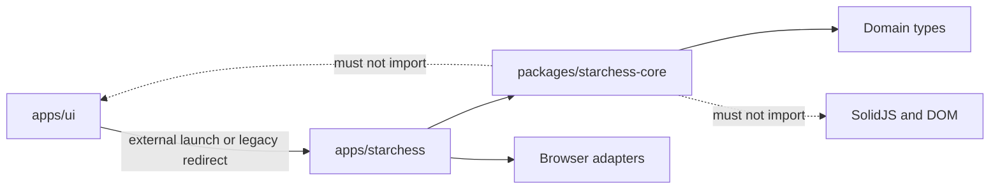
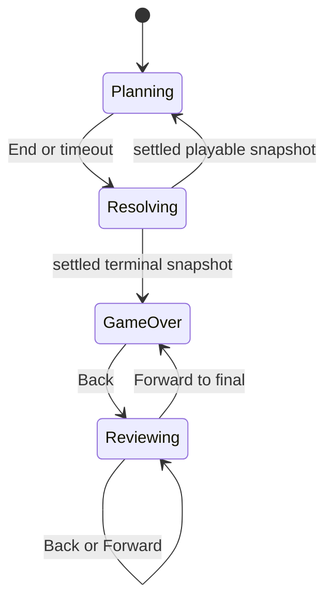

# StarChess standalone app migration

Status: in progress

This document plans the extraction of StarChess from `apps/ui` into an
independent SolidJS application, the architectural cleanup needed to make that
boundary real, its deployment as a scoped PWA at `/starchess`, terminal
game-history navigation, Dockerized Playwright/e2e, and the product upgrades for
promotion, gas-used fog reveal, and gas-step animation.

Implementation has started on branch `feat-nerd-mode`. Progress notes:

- **Done — Phase 1:** `@chess-coach/starchess-core` owns rules; UI facades;
  golden + differential tests.
- **Done — Phase 2:** standalone `apps/starchess` Solid/Vite shell; match
  reducer + explicit phases; snapshot board (no `gameStore` / `useChessBoard`);
  `?scfen=` deep-link; queue → `endScTurn` → injected timeline → terminal
  `gameOver`; zero `apps/ui` imports.
- **Done — Phase 3 (slice):** nerd piece assets under `public/pieces/nerd` with
  `BASE_URL` URLs; timeline projector (gas-step moves, promo hold→deploy);
  gas-used fog reveal; `StarChessScenarioHarness` + `StarChess/*` stories;
  `check:bundle` green; **Storybook running on :6007** with 9 StarChess stories
  (`build-storybook` + live `storybook --ci` verified).
- **Still open:** Phase 4 DualNav review polish in standalone; Phase 5
  PWA/Wrangler; Phase 6 cutover; richer cue VFX port (Attack/Death/Move CSS
  components) beyond the timeline projector; Docker image smoke.

This plan does not authorize Cloudflare deployment or destructive cleanup
without explicit approval.

## Fixed decisions

- Keep SolidJS and Vite. This is an extraction, not a framework rewrite.
- Create a standalone `apps/starchess` application.
- Extract rules into a pure `packages/starchess-core` package.
- Do not create a shared `board-ui` package in this migration. Deduplicate
  StarChess board mechanics locally and leave classical chess UI internals in
  `apps/ui`.
- Ship the first standalone release as an installable PWA on a dedicated
  Cloudflare Worker at `/starchess` and `/starchess/*`.
- Preserve `/chess/starchess` as a compatibility redirect, including its query
  string.
- Use the root pnpm workspace for the new app and package. Do not turn this
  migration into a repository-wide package-manager conversion.
- Add game review after the standalone match-store boundary exists. Keep its
  history session-local and object-based. Do not display SCFEN or add completed
  history to the SCFEN wire format yet.
- Make Playwright runnable via a dedicated Dockerfile, and the e2e suite
  runnable via Docker Compose. Create those files if missing; do not overload
  the existing desktop-engine root `Dockerfile`.
- Treat promotion, gas-step animation, and gas-used fog visibility as product
  upgrades that ship with the migration rather than deferred demos.

## Why this is an architectural migration

StarChess already behaves like a separate product and rules engine, but its
implementation is coupled to Chess Coach:

- `apps/ui/src/index.tsx` mounts `NerdScreen` at `/chess/starchess` because the
  router base is `/chess`.
- `apps/ui/src/starchess/screens/NerdScreen.tsx` combines routing, deep-link
  parsing, economy initialization, action commands, timers, turn resolution,
  animation commits, terminal status, and layout.
- `apps/ui/src/starchess/starChessStore.ts` owns only part of the match and
  imports shared UI settings. `apps/ui/src/store/gameStore.ts` separately holds
  a classical-FEN projection used to render the same position.
- `apps/ui/src/starchess/board/StarChessBoardView.tsx` depends on coach, review,
  travel, capabilities, settings, game history, router, and generic chess-board
  behavior even though StarChess disables most of it.
- `apps/ui/src/starchess/hooks/useStarChessCombat.ts` is both an animation
  timeline player and a store-aware board mutator.
- `apps/ui/src/starchess/types.ts` combines domain snapshots and actions,
  deprecated state models, UI variants, and animation cues.
- `apps/ui/vite.config.ts`, `apps/ui/wrangler.toml`, and `apps/ui/worker.js`
  bind assets, PWA scope, SPA fallback, caching, and deployment to `/chess`.
- The living specifications under `_spec/apps/ui/starchess` describe a separate
  simultaneous-turn engine while still encoding `apps/ui` ownership.

Moving files without correcting these boundaries would produce a nominally
separate app that still imports Chess Coach internals. The migration must remove
those dependencies rather than hide them behind path aliases.

### Structural problems to resolve

- SCFEN replay validation and turn resolution form a rule dependency cycle.
- Rules-side vision depends on presentation animation timing.
- Special kind, actor, cost, targeting, validation, resolution, copy, and demo
  behavior are repeated in several modules.
- Story and demo controllers can implement behavior independently from the
  production queue and resolver.
- The live screen bypasses the store's `endPlanningTurn` boundary.
- The authoritative StarChess snapshot is mirrored into a classical
  `gameStore`, forcing repeated `loadFen` synchronization.
- Game end is terminal in the engine (`phase: "O"`) but incomplete in the UI:
  planning controls remain and no match history exists.
- Classical promotion lands already-promoted in `resolveTurn.relocate`, so a
  mine on the last rank can still kill after the promoted piece is written, and
  there is no "pawn walks off / new unit deploys" sequence.
- `pawnDouble` B/F specials relocate placement immediately with no move cue, so
  gas-stepped pawns teleport.
- Gas-used green highlight (`pieceSpecialUsed`) is applied on the square, but
  fog still hides enemy pieces unless otherwise revealed, so opponents often
  cannot see that a unit spent gas.
- Root `Dockerfile` builds the desktop Chess Coach image with Stockfish/lc0.
  There is no Playwright image and no `docker-compose` / `compose.yml` file for
  e2e.

## Product rule and UX upgrades

These upgrades are part of the migration plan, not optional polish. They must be
specified in `_spec`, implemented in `packages/starchess-core` + the app
timeline, and covered by unit/e2e tests.

### 1. Playwright via Dockerfile; e2e via Docker Compose

Current state:

- Root [`Dockerfile`](Dockerfile) is the desktop product image only.
- [`apps/e2e`](apps/e2e) runs Playwright via npm on the host and documents
  `npx playwright install` in [`apps/e2e/SETUP.md`](apps/e2e/SETUP.md).
- No `docker-compose.yml` / `compose.yml` exists anywhere in the repo.

Plan:

1. Add `apps/e2e/Dockerfile` based on the official Playwright image
   (`mcr.microsoft.com/playwright`), matching the installed
   `@playwright/test` major/minor.
2. Add a root `compose.yml` (or `docker-compose.yml`) with an `e2e` service
   that:
   - builds from `apps/e2e/Dockerfile`;
   - mounts the repo (or copies the workspace) so it can launch the UI under
     test;
   - runs `npm test` / target-selected Playwright for StarChess and the shared
     suite as appropriate;
   - does not require host-installed browsers.
3. Add package/root scripts such as:
   - `docker compose build e2e`
   - `docker compose run --rm e2e`
4. Keep the desktop-engine root `Dockerfile` untouched for product packaging.
5. Document the compose workflow in `apps/e2e/SETUP.md` and this plan's
   verification gates.
6. After StarChess cutover, the compose target must be able to point at
   `apps/starchess` (and optionally still at `apps/ui` for classical specs).

Acceptance:

- A clean machine with only Docker can build the e2e image and run Playwright.
- Compose does not depend on host `npx playwright install`.
- CI/local guidance prefers compose for reproducible browser installs.

### 2. Promotion: pawn walks off the board, then the new unit deploys

Desired presentation for a successful last-rank classical promotion:

1. The pawn performs an ordinary move onto the promotion square as a pawn.
2. The pawn then walks off the board (new animation; leave the file/rank edge).
3. The chosen promoted unit deploys onto that square with the existing deploy
   animation (`DeployCue` / auto-deploy behavior). Keep that deploy behavior.

Rules consequence: promotion must not be an atomic rewrite inside the move
relocate step. The move phase lands a pawn; a later promotion phase converts it.

Domain events to add:

- `pieceMoved` with the pawn still a pawn on the last rank;
- `pawnWalkedOff` / `promotionVacated` from the last-rank square;
- `unitDeployed` for the promoted piece on that square.

If the pawn dies before the promotion phase, neither walk-off nor deploy fire.

### 3. Enemy spider mine interrupts promotion

Scenario:

- A pawn is one square from promoting.
- An enemy spider mine occupies the promotion square (or wakes on that path /
  destination according to existing mine rules).
- The pawn's classical move is interrupted by the mine.
- The promoted unit never deploys.

Recommended resolve order:

```text
king-checks → B specials → classical attack → classical move (+ mine triggers)
  → promotion resolution → F specials
```

Promotion resolution means:

1. Collect survivors that completed a classical move onto their promotion rank
   with a queued `promotion` choice.
2. For each survivor, emit walk-off then deploy the promoted unit.
3. If a mine blast (or any earlier death) removed the pawn, skip that promotion
   entirely.

Today `resolveTurn.relocate` writes the promoted piece first and only then
applies destination/path mine death. That can leave the wrong intermediate
identity and makes "unit never gets deployed" hard to express. Move promotion
after attack/move/mine settlement.

Required tests:

- Core unit: pawn promotes cleanly → final piece is the chosen unit; events
  include move (as pawn), walk-off, deploy.
- Core unit: pawn one step from last rank into an enemy mine → pawn dies, no
  promoted piece, no deploy event.
- E2E: seed SCFEN with a white pawn one square from promotion and a black
  spider mine on the promotion square; queue the promoting classical; End;
  assert the mine resolves, the pawn is gone, and no promoted unit appears /
  no deploy overlay for the promotion. Prefer a dedicated
  `apps/e2e/tests/starchess-promotion.spec.ts` (or an additions block in the
  exceptions suite).

Also update `_spec/.../resolve.puml` so promotion is an explicit post-move
phase, not an in-relocate rewrite.

### 4. Enemies can see gas-used units (green highlight)

Current behavior:

- `specialsUsedThisTurn` drives `data-special-used` / `.pieceSpecialUsed`.
- Fog still hides enemy pieces unless the square is lit or otherwise revealed.
- Intent canisters and other overlays are already fog-gated; gas-used glow is
  not a reveal rule today.

Required product rule:

- If a unit has spent gas this planning turn (`U:` / specials-used set), enemy
  viewers who would otherwise fog-hide that piece must still see the unit with
  the green gas-used highlight.
- This is a vision/reveal rule, not only a CSS tweak: treat gas-spent squares
  like temporary reveals for the opposing viewer, similar to attack-origin
  reveals.
- Own-side gas-used glow continues to work as today.
- When the special is removed from the queue / gas is refunded, the reveal and
  glow clear with `specialsUsed`.

Implementation notes for the plan:

- Core/app vision projection accepts `specialsUsed` as an additional reveal
  source for the opposing viewer.
- Board `hidePiece` must not hide an enemy piece that is gas-marked.
- Keep the existing green highlight styling; do not invent a second marker.
- Cover with unit/component tests and an e2e assertion that an opposing
  viewer/board orientation can observe `data-special-used` on a fogged enemy
  square after gas is spent.

### 5. Gas-moved pawns must animate, not teleport

Current defect:

- `endScTurn` applies `pawnDouble` during B/F by relocating placement.
- `NerdScreen` commits the post-B board, then `useStarChessCombat.playResolve`
  animates classical attacks/moves only.
- Result: gas-stepped pawns snap/teleport.

Required behavior:

- `pawnDouble` emits a semantic `pieceMoved` (or `gasStepMoved`) event with
  from/to and pawn identity.
- The timeline projector plays the ordinary move slide for that event before
  continuing later phases.
- B+C / C+F stacks remain correct: gas step animates, then classical animates
  (or classical then gas ride), without collapsing both into one teleport.
- Queen warp may remain a teleport/special VFX; this requirement is specifically
  for gas-moved pawns.

Tests:

- Timeline/unit: a B-only `pawnDouble` produces a move cue with progress, not
  an instant occupancy swap.
- E2E or Storybook harness: gas step visibly leaves `from` before occupying
  `to`.

## Target architecture

Dependencies must point in one direction:



### `packages/starchess-core`: functional core

Proposed layout:

```text
packages/starchess-core/
  package.json
  tsconfig.json
  src/
    model/
      square.ts
      piece.ts
      action.ts
      snapshot.ts
      outcome.ts
      events.ts
      turn-record.ts
    board/
      placement.ts
      geometry.ts
      moves.ts
      vision.ts
      mines.ts
      siege.ts
    rules/
      economy.ts
      validation.ts
      specials/
        registry.ts
        spawn.ts
        pawn-double.ts
        spider-mine.ts
        bishop-charon.ts
        rook-siege.ts
        queen-jump.ts
    commands/
      queue-action.ts
      remove-action.ts
      submit-turn.ts
    resolve/
      king-checks.ts
      classical-turn.ts
      resolve-turn.ts
    scfen/
      parse.ts
      format.ts
      queue-codec.ts
      errors.ts
    replay/
      validate-history.ts
    ai/
      adjutant.ts
    index.ts
  tests/
```

The package must:

- Have no SolidJS, DOM, browser-global, CSS, animation-duration, or app imports.
- Expose pure commands that accept immutable values and return next state plus
  semantic events.
- Own StarChess-native domain types. `Square`, color, piece, action, snapshot,
  and outcome types must not depend on UI settings types.
- Keep SCFEN as a compatibility adapter around the domain rather than using its
  serialized shape as the entire application store.
- Preserve existing queue order and B/C/F turn semantics.
- Keep its public `index.ts` narrow so app consumers cannot couple themselves to
  internal folders.

`chess.js` may remain temporarily behind a compatibility adapter where removing
it would change behavior, but the target core must not use a classical
`Chess` instance as its state container.

### `apps/starchess`: imperative shell

Proposed layout:

```text
apps/starchess/
  package.json
  tsconfig.json
  vite.config.ts
  vitest.config.ts
  wrangler.toml
  worker.js
  index.html
  src/
    main.tsx
    app/
      StarChessApp.tsx
      StarChessScreen.tsx
      createMatchStore.ts
      matchReducer.ts
      selectors.ts
      effects.ts
    ports/
      Clock.ts
      Scheduler.ts
      RandomSource.ts
      Storage.ts
      Location.ts
    adapters/browser/
      browserClock.ts
      browserScheduler.ts
      browserRandom.ts
      localMatchStorage.ts
      queryScfen.ts
    presentation/
      board/
        StarChessBoard.tsx
        StarChessSquare.tsx
        BoardGrid.tsx
        useBoardInput.ts
        fogProjection.ts
        intentProjection.ts
      timeline/
        timelinePlayer.ts
        eventProjection.ts
        components/
      hud/
        ResourceBar.tsx
        TurnQueue.tsx
        TurnControls.tsx
        DeployModal.tsx
        GasDeploy.tsx
        DualNavButton.tsx
        OutcomeStatus.tsx
      layout/
        MatchLayout.tsx
    stories/
      StarChessScenarioHarness.tsx
      fixtures/
    styles/
      theme.css
      index.css
  public/
    pieces/nerd/
```

The application must:

- Own one match aggregate instead of coordinating several global stores.
- Render directly from a StarChess snapshot rather than mirroring it into
  `gameStore`.
- Use a StarChess-native board input controller rather than carrying
  `useChessBoard`, Stockfish, coach behavior, travel, or classical review into
  the bundle.
- Own its theme tokens, responsive layout, piece assets, and navigation.
- Resolve public assets from `import.meta.env.BASE_URL`; no `/chess/pieces/...`
  URLs may remain.
- Use the same commands and resolver in production, tests, Storybook, and demos.

### Remaining `apps/ui` integration

After cutover, `apps/ui` should know StarChess only as an external product
destination:

- Keep the Nerd name/unlock prompt only if it is still part of Chess Coach's
  product flow.
- Change StarChess launch actions to `/starchess/`.
- Retain a small `/chess/starchess` route that performs an external redirect
  while preserving `location.search` and `location.hash`.
- Remove StarChess capabilities, provider branches, stores, stories, and tests
  only after standalone parity is proven.
- Do not import source from `apps/starchess` back into `apps/ui`.

## Architectural upgrades and design patterns

### 1. Functional core, imperative shell

Rules are deterministic functions. Browser concerns remain at the edge.

- Core commands return a next state and semantic events.
- Timers, random values, URL access, local storage, Solid signals, and animation
  scheduling are injected through app ports.
- Core tests run as plain TypeScript without DOM setup, fake browser stores, or
  global Solid signals.

This separates game correctness from animation timing and allows replay,
simulation, and AI to use the same rules.

### 2. Reducer with an explicit application state machine

Replace distributed flags such as `resolving`, `spawnPhase`, deadline
nullability, and inferred UI modes with explicit states:

- `loading`
- `planning`
- `targeting`
- `resolving`
- `gameOver`
- `reviewing`

The reducer owns legal transitions. Invalid commands return a typed rejection
or no-op. Terminal game state is absorbing. Effects such as scheduling a
timeout, playing a timeline, persisting state, and navigating are described
separately and executed by the shell.

### 3. Strategy registry for specials

Create one registry entry per `ScSpecialKind`. Each entry owns:

- actor piece type;
- gas cost;
- allowed B/F timing;
- targeting policy;
- deep validation;
- queue normalization;
- resolver.

Presentation copy and icons may remain app metadata keyed by the same kind, but
cost and legality must have one authoritative source. Remove duplicate
`SpecialKind`/`ScSpecialKind` declarations and retired queue/state models after
confirming they have no consumers.

### 4. Domain events and a timeline projector

The core should emit semantic events such as:

- `attackStarted`;
- `pieceDestroyed`;
- `pieceMoved`;
- `mineTriggered`;
- `kingDamaged`;
- `specialResolved`.

Events must contain game meaning, not CSS classes or milliseconds. Add events
for promotion walk-off / deploy and for gas-step moves so the timeline can
animate them independently of classical C moves. The app projects events into
animation cues and controls timing through an injected, cancellable scheduler.
Reset, deep-link load, unmount, and history seek must cancel pending effects.

This removes the rules-to-animation dependency and turns
`useStarChessCombat` into a presentation adapter rather than a second rules
engine.

### 5. SCFEN anti-corruption layer

SCFEN remains the compatible wire format, but not the in-memory store shape.

- Parsing and formatting cannot invoke turn resolution.
- Replay validation runs after parsing through a separate service, breaking the
  current dependency cycle.
- Existing `Q:`, `M:`, `S:`, `U:`, and legacy `H:` fixtures retain byte or
  semantic compatibility as appropriate.
- Minerals and completed history remain explicitly outside SCFEN in this
  migration.
- The pending completed-history serializer must not appear in diagrams as
  shipped behavior.

### 6. Single match aggregate

One app store owns:

- live snapshot;
- economies;
- viewer side;
- deadline;
- application state;
- transient targeting;
- timeline state;
- outcome;
- settled history;
- review cursor.

Selectors derive gas, HP, siege state, fog, available commands, status, and the
displayed snapshot. The live snapshot remains authoritative; seeking through
history never mutates it.

### 7. Scenario harness instead of alternate controllers

Storybook and demos should seed a fixture, issue production commands, and
control an injected scheduler. Remove demo-only special hooks once equivalent
scenarios pass through the production reducer and special registry.

## Migration phases

### Phase 0: stabilize and characterize

1. Select an explicit baseline after reviewing the current uncommitted
   StarChess and spec work. Do not discard or overwrite it.
2. Record the current results for UI typecheck, lint, unit tests, Storybook, and
   both StarChess Playwright specs.
3. Build a golden SCFEN and resolve corpus covering:
   - omitted and populated optional fields;
   - queue ordering and removal;
   - B+C and C+F pawn rewrites;
   - king checks, duel, mutual death, and draw;
   - mines and mine collisions;
   - siege mode;
   - fog-edge and path-reveal resolution;
   - terminal phase;
   - legacy `H:`.
4. Preserve the existing spawn-then-move failure and siege-toggle skip as known
   product gaps. Migration must not silently classify them as regressions or
   fixes.
5. Capture golden cases for the new product upgrades as failing or pending
   fixtures until implemented:
   - promotion walk-off + deploy;
   - promotion interrupted by enemy spider mine;
   - gas-used enemy reveal under fog;
   - gas-step pawn move animation (no teleport).
6. Confirm Playwright can be imaged and that compose scaffolding is planned
   before relying on host browsers for StarChess e2e.

Exit gate: the baseline and known gaps are reproducible.

### Phase 1: extract the core behind a compatibility facade — **DONE**

1. Add `@chess-coach/starchess-core` to the pnpm workspace. ✅
2. Move domain types, board operations, validation, SCFEN codecs, actions,
   resolution, outcome, and Adjutant logic in small slices. ✅
3. Keep temporary adapters at old `apps/ui` import paths while consumers move. ✅
4. Split presentation/animation types out of the current mixed type file. ✅
   (`types.ts` re-exports domain; attack/move cues stay UI-local.)
5. Move replay validation out of SCFEN parsing. ✅ (`replay/validate-history.ts`)
6. Move animation durations out of rules-side vision. ✅
   (rules in core; SVG / move-path occupancy helpers in UI `vision.ts`;
   `ATTACK_MS` etc. stay in UI `constants.ts`.)
7. Introduce the special registry without changing wire format yet. ✅
8. Change classical promotion so relocate lands a pawn; add an explicit
   post-move/mine promotion phase before F specials. ✅
9. Emit gas-step move events from `pawnDouble` instead of silent placement
   teleport. ✅
10. Move rule-focused tests into the package and add differential tests that
    run old and extracted implementations over the golden corpus, plus new
    promotion/mine and gas-step cases. ✅
    (`packages/starchess-core/tests/*`, UI `coreFacadeDifferential.test.ts`)

Exit gate: the current embedded UI consumes the package and all differential
tests pass for preserved behavior; new upgrade tests are present and define
the intended contract. ✅

Rollback: retain old modules until each replacement has parity; remove only the
adapter for a completed slice.

### Phase 2: create the standalone shell and match aggregate — **DONE**

1. Scaffold SolidJS, Vite, Vitest, lint, format, and Storybook configuration in
   `apps/starchess`. ✅
2. Add the app reducer, explicit state machine, selectors, effects, and browser
   ports. ✅
3. Move `NerdScreen` responsibilities into focused application commands and
   presentation components. ✅ (`StarChessScreen` + `MatchHud`)
4. Implement a StarChess-native board input controller. ✅ (`useBoardInput`)
5. Render placement directly from the selected StarChess snapshot. ✅
6. Remove `gameStore` and repeated `loadFen` synchronization from the
   standalone path. ✅
7. Copy only the small primitives StarChess needs, then simplify them under
   app ownership instead of importing from `apps/ui`. ✅
8. Keep `/chess/starchess` on the embedded implementation until standalone
   behavior is verified. ✅ (untouched)

Exit gate: a local standalone game can deep-link from SCFEN, queue actions,
resolve a turn, animate it, and reach a terminal outcome without importing
`apps/ui`. ✅

### Phase 3: consolidate presentation, demos, and assets — **DONE (exit gate)**

1. Move StarChess animation components and CSS under the new app. ✅
   (timeline projector + board/HUD CSS; full Attack/Death SVG ports deferred)
2. Replace store-aware combat orchestration with the domain-event timeline
   projector. ✅ (`timelinePlayer.ts`)
3. Inject scheduler, clock, and random source so tests can advance effects
   deterministically. ✅
4. Implement the new promotion walk-off animation, then reuse existing deploy
   cues for the promoted unit. ✅ (promoHold → deploy cues; off-board polish later)
5. Animate `pawnDouble` gas steps with ordinary move slides; keep queen warp as
   a distinct special VFX if desired. ✅ (gas-step move cues)
6. Teach fog/reveal projection to show enemy gas-used units with the existing
   green highlight. ✅ (`fogProjection` + `data-special-used`)
7. Create one `StarChessScenarioHarness`. ✅
8. Convert demos and stories to fixtures plus production commands. ✅
9. Delete alternate special controllers only after equivalent scenarios pass. ✅
   (standalone has no alternate controllers; UI demos retained until Phase 6)
10. Move Nerd piece assets into the standalone public tree. ✅
11. Replace hard-coded `/chess` asset references with base-aware URLs. ✅
12. Add a bundle-boundary check proving that Stockfish, WebLLM, coach services,
    and Chess Coach stores are absent. ✅

Exit gate: production, stories, and tests use one resolver and command path;
promotion, gas-step animation, and gas-used enemy reveal behave as specified;
**Storybook runs with `StarChess/*` stories.** ✅
(`pnpm --filter @chess-coach/starchess storybook` → http://localhost:6007/)

### Phase 4: terminal history review

Use a Memento-style immutable history inside the match aggregate.

#### History model

- Seed `settledSnapshots` with the initial position.
- After each resolve timeline finishes, append exactly one settled
  `result.next`.
- Retain a turn record containing `before`, `after`, outcome, and semantic
  events. The initial UI seeks only settled `after` snapshots, while the event
  data leaves room for future animated replay without changing the model.
- Keep `liveSnapshot` and `reviewIndex` separate.
- Derive `displayedSnapshot` from the cursor. Never seek by rewriting the live
  snapshot or classical `gameStore`.
- Append only after the animation completes, preventing duplicate End/timeout
  records and partial positions.

#### Terminal behavior

- Determine game end from the live snapshot/outcome, not the viewed historical
  snapshot. The controls must remain visible when the user seeks backward.
- When the live phase becomes `"O"`:
  - cancel the planning timer;
  - close targeting/deploy UI;
  - clear transient combat effects;
  - make board input read-only;
  - hide Turn controls and GasDeploy;
  - replace the top planning chrome with the dual navigation arrows.
- Labels are plain review labels such as `Start`, `Turn 2 of 3`, and `Final`.
  Do not display SCFEN.
- Back decrements and Forward increments a clamped review cursor.
- Disable Back at the first snapshot and Forward at the final snapshot.
- Left/Right keys work only during terminal review.
- Keyboard handling ignores inputs, textareas, selects, content-editable
  elements, and modified shortcuts.
- Preserve accessible `Go back` and `Go forward` labels and visible focus.
- A terminal SCFEN deep link has one settled snapshot; both arrows still display
  but are disabled.
- Refresh persistence, animated replay, and SCFEN history serialization are
  deferred.



#### History tests

- Initial snapshot and one snapshot per completed turn are immutable.
- End and timeout cannot append the same turn twice.
- Controls do not display before the terminal snapshot settles.
- Both arrows display after every win or draw.
- Cursor bounds disable the correct button.
- Seeking restores placement, lives, mines, siege state, fog, and damaged-king
  presentation together.
- Seeking never restarts timers, animation, deploy effects, or auto-opponent
  behavior.
- Board gestures and special controls cannot mutate a terminal match.
- Left/Right keyboard navigation obeys editable-target guards.
- A terminal deep link has disabled arrows and no fabricated history.

Exit gate: a completed match can scrub all settled positions without showing
SCFEN or mutating the final match.

### Phase 5: deploy as a scoped PWA and Worker

#### Vite and PWA

1. Set Vite `base` to `/starchess/`.
2. Output the route-mirrored artifact to `dist/starchess`.
3. Add a dedicated StarChess manifest:
   - `start_url: "/starchess/"`;
   - `scope: "/starchess/"`;
   - `display: "standalone"`;
   - StarChess-specific name, description, colors, and icons.
4. Register the service worker at `/starchess/sw.js`.
5. Use StarChess-specific cache names.
6. Precache the small application shell, piece art, CSS, scripts, fonts, and
   icons.
7. Do not inherit engine model caches, WebLLM caches, worker rules, or the
   current 8 MiB Stockfish exception.
8. Verify that the service worker cannot control `/chess/` or `/`.

#### Wrangler and Worker

Create a dedicated Wrangler application named `starchess`:

- assets directory: `dist`;
- asset binding: `ASSETS`;
- `run_worker_first = true`;
- route: `proveo.ca/starchess`;
- route: `proveo.ca/starchess/*`.

Worker behavior:

- Redirect `/starchess` to `/starchess/`.
- Keep the canonical SCFEN deep-link form
  `/starchess/?scfen=...`.
- Preserve the query string during canonicalization.
- Serve normal assets before applying fallback.
- Fall back to `/starchess/index.html` only for navigation requests.
- Return a real 404 for missing JavaScript, CSS, images, manifests, and other
  assets instead of returning HTML.
- Apply `no-cache` to HTML, manifest, registration, and service-worker
  bootstrap files.
- Keep content-hashed assets immutable/cacheable.
- Do not add COOP/COEP unless a retained dependency is proven to require
  `SharedArrayBuffer`; the standalone StarChess rules engine does not.
- Avoid the current per-request production debug logging.

Add root/package scripts for build, test, preview, Wrangler dry-run, and deploy.
`wrangler deploy` remains an explicit, separately approved publishing action.

#### Compatibility redirect

After production smoke tests pass:

- replace the embedded `/chess/starchess` route with a minimal external
  redirect;
- preserve `location.search` and `location.hash`;
- update Chess Coach launch links to point directly to `/starchess/`;
- retain the redirect for existing bookmarks and shared SCFEN URLs.

Exit gate: the app installs, reloads offline, updates safely, and owns only the
`/starchess/` service-worker scope.

### Phase 6: cut over and remove coupling

1. Add `apps/e2e/Dockerfile` and root `compose.yml` if still missing; document
   and assert `docker compose build e2e` + `docker compose run --rm e2e`.
2. Add a dedicated StarChess Playwright target whose base URL and web server
   point to `apps/starchess`.
3. Change deep-link tests to the canonical
   `/starchess/?scfen=${encodeURIComponent(scfen)}` form.
4. Add/keep the promotion-vs-mine e2e, gas-used fog reveal assertion, and
   gas-step animation coverage in the StarChess suite.
5. Run standalone and classical UI regression suites, preferably through
   compose for browsers.
6. Switch product links and the compatibility route.
7. Remove embedded components, provider seams, global-store fields, stories,
   and tests only after import searches show no live consumers.
8. Remove the `apps/ui/src/starchess` tree only after all rules, UI, fixtures,
   tests, assets, and spec backlinks have an owned destination.
9. Inspect the built artifact for stale `/chess/` URLs and forbidden
   dependencies.

Exit gate: `apps/starchess` has no source imports from `apps/ui`, while
`apps/ui` contains only the launch integration and compatibility redirect;
Playwright is runnable via Docker and e2e via compose.

## Living-spec migration

Specifications must move according to ownership, not as one mechanical
directory rename.

### Application specs

Create `_spec/apps/starchess/` with:

- `index.puml`: standalone app and dependency boundary;
- `components.puml`: application store, board, HUD, timeline, adapters, and
  stories;
- `starchess-mode.puml`: product rules and shipped/pending UX;
- `demos.puml`: scenario harness and fixtures;
- `deployment.puml`: Vite artifact, PWA scope, Worker routes, fallback, and
  legacy redirect;
- `review-history.puml`: terminal transition, settled history, cursor, and
  read-only board.
- Product notes in `starchess-mode.puml` / timeline specs for promotion
  walk-off+deploy, gas-used enemy reveal, and gas-step move animation.

### Core specs

Create `_spec/packages/starchess-core/` with:

- `index.puml`;
- `scfen-wire.puml`;
- `scfen-queue.puml`;
- `resolve.puml`;
- `turn-queue-sequence.puml`;
- `sc-moves.puml`.

The app-side board-input/provider flow belongs in the app component spec. The
core move-generation rules belong in the package spec. The target diagrams must
not preserve `useChessBoard` as the integration seam.

Rewrite `resolve.puml` so promotion is an explicit phase after classical
move/mine settlement and before F specials. Document that a mine death on the
promoting pawn cancels walk-off and deploy.

### Spec corrections

- Correct stale `src/types/starchess.ts` references.
- Correct test and Storybook paths.
- Distinguish the public `/starchess/` route from the old
  `/chess/starchess` route.
- Remove the stale claim that board-driven king adjacency is unavailable.
- Move the pending completed-history serializer out of the shipped resolve
  activity and mark it deferred.
- State clearly that minerals and completed history are not serialized in
  SCFEN.
- Clarify which validation is always enforced and which move-shape checks are
  optional.

### Top-level spec updates

Update:

- `_spec/architecture.puml`;
- `_spec/components.puml`;
- `_spec/summary.md`;
- `_spec/distribution.md`;
- affected `_spec/apps/ui` component, entity, state-machine, and responsive
  specs;
- `CLAUDE.md` spec index and key architecture notes.

For every represented source file:

- place one top-level `// SPEC:` comment;
- comma-separate multiple diagrams on that line;
- move the backlink with the behavior;
- remove stale `_spec/apps/ui/starchess` links;
- ensure every new `.puml` has at least one source backlink.

Validate all PlantUML after each phase rather than postponing spec maintenance
until the end.

## Verification gates

### Core

- Typecheck and lint.
- Unit tests for all commands and rules.
- Golden parse/format tests.
- Differential resolve tests against the migration baseline.
- Property tests for parse/format stability, queue ordering, and state
  invariants where practical.
- Static boundary check for SolidJS, DOM, browser, CSS, and app imports.

### Standalone app

- Typecheck and lint.
- Reducer, selector, adapter, and component tests.
- Deterministic timeline tests with fake ports.
- Storybook build.
- Production build.
- Bundle inspection for `apps/ui`, Stockfish, WebLLM, coach services, and
  shared UI stores.
- Visual coverage for desktop, mobile, fog, deploy, attack, death, mine, siege,
  king damage, outcome, and terminal review.

### Main UI

- Existing typecheck, lint, unit tests, and Storybook.
- Classical coach, analysis, review, and LAN E2E after removal of the
  StarChess move-provider seam.
- Launch-link and compatibility-redirect tests.

### StarChess E2E

- Queue add/remove and gas refunds.
- Every special.
- B/C/F ordering.
- Fog collisions and path reveal.
- Mines and siege.
- King duel, win, and draw.
- Promotion walk-off + deploy on a clean last-rank move.
- Pawn one square from promotion into an enemy spider mine: mine resolves,
  pawn dies, promoted unit never deploys.
- Enemy viewer can see green `data-special-used` on a gas-spent fogged unit.
- Gas-stepped pawn leaves `from` before occupying `to` (no teleport).
- Terminal controls and read-only behavior.
- Complete backward/forward history traversal.
- Keyboard navigation.
- Terminal deep-link behavior.

### Docker / Compose e2e

- `apps/e2e/Dockerfile` exists and builds.
- Root compose file defines an `e2e` service.
- `docker compose build e2e` succeeds.
- `docker compose run --rm e2e` runs Playwright without host browser installs.
- Compose docs in `apps/e2e/SETUP.md` match the actual commands.

### Worker and PWA dry run

- `/starchess` redirects to `/starchess/`.
- Query data survives canonicalization.
- `/starchess/` returns the shell.
- A valid deep navigation request returns the shell.
- A missing asset returns 404, not HTML.
- Assets have correct MIME types.
- The manifest and generated URLs stay under `/starchess/`.
- Offline reload works after installation.
- A new build updates without leaving a stale shell.
- The StarChess service worker does not control `/chess/`.
- Wrangler dry-run succeeds before any real deployment is requested.

### Specs

Run PlantUML validation over both new directories and search for:

- stale `_spec/apps/ui/starchess` references;
- stale `apps/ui/src/starchess` ownership claims;
- unreferenced new diagrams;
- source files with multiple separate `SPEC:` comments;
- references to nonexistent type or test paths.

## Acceptance criteria

The migration is complete only when:

- `apps/starchess` has no imports from `apps/ui`.
- The StarChess production bundle contains no coach, Stockfish, WebLLM, travel,
  or classical review payload.
- `packages/starchess-core` imports no SolidJS, DOM, browser, CSS, animation
  timing, or app modules.
- Golden SCFEN and resolve cases remain compatible.
- Production, tests, Storybook, and demos invoke the same rules and commands.
- The app is installable and works offline at `/starchess/`.
- `/chess/starchess` redirects without dropping SCFEN query data.
- Completed games always show dual arrows.
- Terminal review can seek every settled position without mutating the match or
  displaying SCFEN.
- Successful promotions animate pawn move → walk off board → promoted-unit
  deploy.
- A promoting pawn killed by an enemy spider mine never deploys a promoted
  unit.
- Opponents can see gas-used units via the green highlight even under fog.
- Gas-moved pawns animate instead of teleporting.
- Playwright runs via `apps/e2e/Dockerfile`; the suite runs via Docker Compose.
- Classical Chess Coach behavior still passes its regression suite.
- Living specs and source backlinks accurately describe final ownership.
- A successful local build or dry run is not reported as a Cloudflare
  deployment.

## Risks and rollback checkpoints

- Preserve a passing compatibility facade until core differential tests pass.
- Preserve embedded `NerdScreen` until standalone E2E and visual parity pass.
- Do not claim full replay persistence: minerals and completed history are not
  currently serialized in SCFEN.
- Treat animation parity, fog projection, B+C/F ordering, promotion/mine
  ordering, gas-step timeline events, terminal absorbing behavior, PWA stale
  caches, and route/query canonicalization as high-risk areas.
- Treat Docker/Playwright image drift (`@playwright/test` vs image tag) as a
  recurring maintenance risk; pin versions together.
- Make each consumer cutover independently reversible.
- If a phase fails, revert that phase's cutover rather than rewriting the
  current uncommitted work.
- Do not use destructive Git commands as a migration shortcut.
- Do not deploy, commit, push, or remove compatibility behavior without
  explicit approval at the relevant phase.
