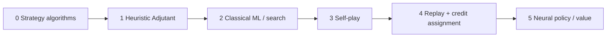

# Adjutant evolution — from strategies to learned opponent

Status: **learning roadmap only; NOT training-ready. R0 CLOSED historically within accepted non-learned assurance. R2 WIP; fresh verification/closure PENDING.**  
Scope: how Single Player’s opponent (`packages/starchess-core/src/ai/adjutant.ts`) grows from named strategy algorithms → a composed heuristic → something that learns, without rewriting the StarChess rules engine.

The preparatory catalog is implemented and verified separately from this learning roadmap;
the verification record includes the existing full-app lint baseline exception:
[`adjutant-definitions.puml`](_spec/packages/starchess-core/adjutant-definitions.puml),
[`menu-flow.puml`](_spec/apps/starchess/menu-flow.puml), and
[`PLAN-ml-adjutant.md`](_spec/_plans/PLAN-ml-adjutant.md).
The registry ID is `machine-learning`; `ml/` names proposed training tooling, not an opponent alias.
`machine-learning`, `rlhf`, and `rlcd` remain EMPTY and unavailable until implemented.
The implemented catalog definitions do not complete any learning stage below.

## Historical R0 foundation — closed then, not current proof

The authoritative [strict ML roadmap](_spec/_plans/PLAN-ml-adjutant.md) records **A01–A15 CLOSED** within accepted non-learned execution/evidence assurance.
Use unchanged [R0 closure JSON](_spec/evidence/ml-adjutant-r0-closure.json) and [historical frozen verification](_spec/evidence/ml-adjutant-r0-refresh/verification.json) for original R0 facts and pins only.
Historical final post-publication adversarial `ses_efe0ed67dffew2su1gZIUaDy23` and security `ses_efe0ed520ffeOEg3kd6jAtN33i` both returned **READY TO CLOSE R0: yes**.
Recorded historical checks: **689/689 arena + 426/426 core**, zero failed/pending/todo; **54 executions + 54 semantic reruns**, parity true; **107 Node tests**, **5/5 actual Docker infrastructure**, and **13/13 host post-publication checks**, no skips.
Those historical host checks included both then-live source pins; all **8 exact verification commands**, including three static checks and both scripts, passed then.
The [original closure/pin record](_spec/_plans/PLAN-ml-adjutant.md#r0-closure--current-frozen-evidence) retains its legacy navigation anchor; none of its pins proves the recovered R2 tree.
This closes assurance, not learning: weights remain **NONE**, no trained artifact or learned acceptance exists, and `machine-learning` stays unavailable.
Lead historically reported both then-updated diagrams passed PlantUML `checkonly` with exit **0** and `git diff --check` passed; this pass reruns neither check.

### Current R2 — WIP, no fresh evidence or acceptance

The [approved R2 V1 bridge / V3 amendment](_spec/_plans/r2-generator-v3.md) and [candidate-generation.puml](_spec/packages/starchess-training/candidate-generation.puml) own the current scoped work.
Executor reports recovered R2 source; archived legacy R0 logs and temporary images are missing.
Require bounded detached DTO inspection (depth **16**, **8192** root/node/edge visits, **1 MiB** total UTF-8 strings/keys), memoized shared subtrees with path-depth checks, cycles/accessors rejection, and frozen `ACTION_KINDS`.
Executor's TUI-approved **Freeze native tables** direction freezes `UNIT_COST`, `SPECIAL_REGISTRY` and every nested special entry at declaration; authoritative costs and native admission/grammar remain unchanged.
Exact public export keys remain core `['.']`, arena `['.','./observations','./intent-codec-v1']`, training `['./candidates']`.
Every conditional workspace export branch, including node/default/unselected branches, must use its canonical approved target, not merely satisfy keys or browser resolution.
Pure core/authorized/training closures use static ESM only and reject literal runtime dynamic imports and computed own-function-member constructor bypasses hidden by `any`, aliases or wrappers; ordinary computed data indexing and reviewed DTO descriptors remain valid. Arena root remains the host barrel.
Fresh eleven-command verification requires a separate mandatory actual Docker infrastructure envelope tied to the captured dependency image and independently joined by the importer.
Infrastructure capture now enforces **six exact ordered test identities (five static + one Docker)** and independently binds the probe invocation; fresh execution remains pending.
Its child receives only fixed PATH, private HOME, fresh empty private DOCKER_CONFIG and immutable image identity; exact recorded-env checks reject inherited preload/Docker endpoint/credential overrides.
Importer requires **`--acquisition`** from **`build --dependencies --no-cache`**, independently joined to dependency-image measurements/controls/input invoice, exact argv and successful untruncated logs; retain acquisition/build/execution/export envelopes plus all declared logs in the published host-provenance namespace.
Generated capture/workspace files explicitly chmod **0644**, and captured child directories **0755**, under umask **077**, without widening the private scratch root.
Both source-container inspections must match the runtime entrypoint, `Cmd=['verify']`, cwd `/app` and exact ordered image Env + output; reject interpreter/linker preloads and bind attachment to the same inspected container.
Current **`r2-assertion-floors-v2`** requires **471 core / 1043 arena / 56 training**. Executor reports core/training passed, source-inventory **321** passed and public checker passed over **88 sources / 7 dependencies**; arena **1043 is enumerated only**, and the complete direct strict invocation is being rerun. These reported host checks are not full frozen verification or independently executed by this spec pass.
The [R2 provenance contract](_spec/_plans/r2-generator-v3.md#72-fresh-acquisition-offline-source-build-and-durable-host-provenance) owns exact acquisition/source vectors, environments, log metadata and retention.
No fresh image, current evidence, R2 acceptance/closure, learned acceptance or training is claimed.

### Historical Phase 1 verification

The separate strict-challenge roadmap now owns Phase 1 in `packages/starchess-arena`:
[`ml-adjutant-challenge-harness.puml`](_spec/packages/starchess-arena/ml-adjutant-challenge-harness.puml).
Phase 1 is IMPLEMENTED; the following records its historical verification, not the current R0 generation.
The lead historically reported adversarial and security reviews READY: yes for the trusted non-learned scope.
Then-final arena verification passed 164 tests / 17 files after all source/test changes, arena
typecheck, and the strict test TypeScript check; that core run passed 426 tests / 53 files with typecheck passed.
Historical evidence:
[`baseline-report.json`](_spec/evidence/ml-adjutant-phase1/baseline-report.json) and
[`verification.json`](_spec/evidence/ml-adjutant-phase1/verification.json).
All 54 historical semantic reruns matched; candidate wins remain 0/18 corpus and 0/36 live strategic.
This completes the non-learned harness baseline, not learned acceptance.
Both renamed diagrams and the edited spec map historically passed PlantUML `checkonly`.
Historical Phase 2 hermetic verification PASSED in arena; its records remain below. This is not a learned PASS.
Current policy/assurance boundary:
[`ml-adjutant-policy-contracts.puml`](_spec/packages/starchess-arena/ml-adjutant-policy-contracts.puml).

### First-training prerequisites — still pending

Executor chose **Broader first trained ranker**:
[`ml-adjutant-weights.md`](_spec/_plans/ml-adjutant-weights.md).
FIRST Phase 3 training requires a separately versioned combination generator and v2 authorized
economic/positional interactions, own-loss lineage ledger, and confirmed opponent-loss lower bounds with fog uncertainty.
The selected **turn-aware calibrated belief** also requires a versioned amendment before training.
Its public turn-0 prior is **4 surviving deployed combat replacement + 3 banked minerals = 7**, excluding CC; endowed opening units have paid basis **0**.
Compare known own surviving combat replacement material against the authorized-history estimate of enemy surviving deployed combat replacement material under equivalent valuation.
Keep deployed material and inferred enemy bank as separate components; neither is an exact hidden-state or historical-payment oracle.
Use native `incomeForTurn(t)` and `applyStoredIncome` at actual income-grant boundaries, not planning ordinals, frame counts, or turn changes alone.
Exact belief architecture, calibration data/objective/thresholds, and versioned feature amendment remain **PENDING**; the prior frozen **370**-field v2 contract does not supply a calibrated model.
The [canonical economic gate](_spec/_plans/PLAN-ml-adjutant.md#selected-economic-extension--pre-training-gate) and [R1 amendment contract](_spec/_plans/ml-adjutant-r1-contracts.md#21-selected-economic-extension--amendment-pending) own the details; do not duplicate or silently amend their recipe here.
R1 amendment and R2–R5 implementation/readiness must close before explicit R6 training approval; R7 artifact/runtime validation precedes R8 learned acceptance.
Current named feature arrays (ranker 158 / action 64 / observation 1623) have **no weights** and are not adequate
for that first trained ranker. Start at H=1; three conditional simultaneous planning windows are separate future work.
Training, learned models/artifacts, and browser rollout remain unimplemented; registry entries stay EMPTY/unavailable.

### Historical Phase 2 image and evidence snapshot

The following records the earlier Phase 2 generation, not a current recovered-tree/R2 image, verification, or review verdict.
Keep these results and hashes unchanged as history; use the historical R0 foundation above for original closure navigation and the R2 amendment for current pending work.
The historical source image is `sha256:e7f9ea8ac211c93804bd1125ed28fb7e165a160c4155ca70404c81f9e431710d`.
The lead historically reported the then-fresh dependency image `sha256:4c9d45b04f325a2d912cb34ebc982f139f057a2f2fb6d779ac2ef59f29ea987d`.
The official Node 22.23.2 bookworm-slim platform digest recorded for that snapshot is
`sha256:43aeff40f4afc22e83f7589a2f37e111cff5ca84529571f1c8415bcc5fcc21b2`.
That historical image run passed network-none, read-only, and nonroot.
Baseline 54 executions plus 54 reruns are semantically equal.
`executionIntegrity` is true. `learnedGateEligible` is false.
Results are unchanged: corpus 18 scheduled, 0 wins, 2 terminal losses, 16 queue-rejected;
live strategic 36 scheduled, 0 wins, 36 terminal losses.
Coverage is representability, not winning coverage: exact queues 18/282, singleton intents 204/576,
codec 282/282, features 282/282.
In-image vitest passed core 426/426 and arena 434/434.
In-image core and arena typecheck passed, and the strict test `tsc` passed.
The lead historically reported host-after-import checks passed 7 tests / 2 files, and arena typecheck passed.
Historical evidence remains under `_spec/evidence/ml-adjutant-phase2/`. Phase 1/2 original bytes remain unchanged.
Historical Phase 2 baseline SHA-256 is `5de86d94caaa626402b73ac9fa8f6bbc7a9b111e69a8b3801461380635cbd87f`.
The [pre-rename evidence bundle](_spec/evidence/ml-adjutant-phase2-before-diagram-rename/verification.json)
is historical; the [post-rename historical verification](_spec/evidence/ml-adjutant-phase2/verification.json) records the then-fresh execution after pointer relocation, not current R0 repairs.
The external archive SHA-256 `64d6277f439f7cdfb82ecb2c6a230f735c5c7f3588d7f13082a30b430e6d07f7`
is not in the repo. The lead reports its path as `/tmp/opencode/starchess-hermetic-export-k1KYQO/image.tar`.
Earlier scoped pre-freeze findings were reported fixed before that historical freeze. Rename-only adversarial review was **READY: yes**.
Full implementation post-image security rereview was unrecorded at that snapshot; both renamed diagrams and the spec map had passed PlantUML `checkonly`.
Those historical approvals do not replace current R0 closure or satisfy remaining training gates; use the authoritative strict roadmap linked above.
This historical evolution ladder does not override the authorized-observation/no-fallback challenge contracts.

This replaces the prior standalone-migration PLAN (Phases 1–6 are done).

---

## Why this ladder exists

The Adjutant already *plans* a turn: score legal specials + classical moves, pick a queue, commit via `addScAction`. That is enough for a fun scripted foe. It is **not** enough for:

- long-horizon economy (minerals → spawn → map control),
- counter-play that adapts to *your* habits,
- opening / mid / endgame style shifts without hand-tuning weights.

The path below starts with the **strategy catalog** (what the script is made of), then the usual industrial sequence (AlphaZero-style), adapted to StarChess’s simultaneous B/C/F turns, gas budget, fog, and SCFEN replay surface.



Each step keeps the **same rules API**: `ScFenSnapshot` in → queued actions out → `endScTurn` resolves. Learning never forks a second ruleset. Color is agnostic (`ctx.color` = side to plan).

---

## 0. Strategy algorithms — named tactics before the heuristic

**What it is:** a catalog of *individual* strategy algorithms. Each one answers a narrow question (“how do I save my King?”, “where do I plant the next mine?”) and emits scored candidates. The heuristic (stage 1) only **selects posture** and **blends weights** across these strategies.

Think of strategies as pure policy fragments; postures decide which fragments are loud this turn.

### Categories (posture families)

| Category | Intent | Typical posture gate |
|---|---|---|
| **Survive** | Do not lose the King / flagship this turn | Always on; overrides everything |
| **Control** | Own the map (hub, mines, diagonals, siege) | `expand` — no hub yet; dampened later |
| **Seek** | Find a fogged enemy King from clues | `seek` — hub held, King not visible |
| **Attack** | Chip / chase / check the visible King; equal-material trades | `hunt`; equal trades always |
| **Defend** | Save threatened units — queen if savable, else flee non-queens | When in enemy range |
| **Develop** | Promote, spawn, trades when higher goals idle | Secondary in seek/hunt |
| **Combo** | Same-turn gas stacks (Charon+C, mine+hop, …) | Whenever gas + legality allow |

### Individual strategies (by category)

**Survive**

- **King safety** — any plan that leaves our King on a chip ray is crushed (`KING_SAFETY`).
- **Flee / interpose** — classical or special that clears check.
- **BattleShip escape** — `queenWarp` to a safe square when the queen is under fire (`QUEEN_ESCAPE`).

**Control**

- **Siege hub** — walk / pack Siege Tank on d4–e5.
- **Spider mines** — plant on d4–e5 first; once the hub is mined, plant on **a/h** files only.
- **Hoverbike hop** — move knights onto preferred mine sites (hub, then flanks).
- **Mecha diagonals** — bishops claiming centre-biting rays.
- **Spawn for presence** — Command Center drop toward contested tiles (minerals permitting).

**Seek** (fog intel — enemy-color aware)

- **Pawn-file corridors** — each visible enemy pawn’s **file** is a deploy corridor back to the enemy home band (ranks 1–2 if enemy is White, 7–8 if Black).
- **Pawn clumps** — dense Marines reinforce those files (shelter ⇒ King nearby).
- **Deploy cues** — visible non-pawn enemy units (spawned beside their King); back-rank bias.
- **Siege-to-reveal** — pack tank when 9×9 would cover the intel focus.
- **Scout hop** — close Chebyshev distance to the inferred focus.

**Attack**

- **Check / ray** — land where we attack the visible enemy King (not onto the king square).
- **Chase** — reduce Chebyshev distance to the visible King.
- **Equal-material trade** — when in range of an enemy of the same `UNIT_COST`, always capture.
- **Charon snipe** — bishop gas kill on a unique diagonal enemy queen (+ second classical strike).

**Defend**

- **Savable queen** — `queenWarp` / classical flee to a safe square when the BattleShip is under fire.
- **Threatened non-queen** — leave the fire (defend) rather than hang; do not walk into fresh fire.

- **Promote** — push / promote; **near-promote rush** (≤2 steps, ~6000) including gas+move stack outranks control/seek/hunt mid goals.
- **Pawn gas stack** — B+C two-step when free classical double is unavailable (mandatory when 2 steps from last rank).
- **Trades** — capture when value favors us; avoid hanging units.

**Combo**

- Charon (B) + classical (C)
- Mine (B) + Hoverbike relocate (C)
- Spawn (B) + classical (C)
- Threatened warp (B) + second unit (C)

### Composition rule

```text
for each legal candidate (special / classical / stack):
  score = Σ strategy_i(candidate, snap, vision, posture_weights)
pick max score (King-safety gate applied uniformly)
```

Posture (`expand` | `seek` | `hunt`) only changes **weights**, not which strategies exist. New tactics should land here as named strategies before they become magic numbers inside `scoreMove`.

**Stay here until:** every shipped behaviour has a named strategy + unit test; posture table is documented (as in `WEIGHTS` today).

---

## 1. Algorithm (today) — heuristic planner

**What it is:** the **composer** over stage-0 strategies — fixed posture resolution + hand weights.

- Enumerate legal specials within gas, classical moves via `scMovesFor`, same-turn stacks.
- Resolve posture from hub presence + fog (enemy King visible?).
- Score with dynamic weights (survive ≫ control in expand ≫ seek / attack by posture).
- Deterministic: same snapshot + `color` → same plan (good for tests, demos, Storybook).

**Strengths:** cheap, explainable, shippable, unit-testable.  
**Limits:** weights are opinions; no look-ahead beyond “this queue looks good”; no memory of prior games; fog / bluffs are shallow.

**Stay here until:** candidate generation is complete (all specials + meaningful stacks) and evaluation features are stable enough that a learner would not fight the rules API every week.

---

## 2. Machine learning algorithm — learn the *score*, keep the *search*

Still an algorithm; only the **evaluation** (and optionally action ranking) is fit from data.

Typical first ML step for this codebase:

| Piece | Role |
|---|---|
| Features | material, minerals, gas left, king HP/threat, mines near hub, siege flags, vision size, promote distance, center control, intel focus, … |
| Model | linear / GBDT / small MLP that outputs a **position value** or **action logits** |
| Search | keep Adjutant’s candidate generator; optionally add shallow tree / beam over *queues* (not just single moves) |
| Train signal | game outcome (±1), or stronger: turn-level rewards (king damage, mines planted, Ship saved) |

This is **supervised / offline RL-lite**, not yet a neural StarCraft-scale stack. Humans or the heuristic Adjutant can label “good queues”; a regressor learns to imitate or to predict win probability.

**Product shape:** `adjutant(snap, ctx)` stays pure; a second entry `adjutantLearned(snap, weights)` swaps the score function. Tests pin the heuristic forever as a baseline / fallback.

---

## 3. Plays itself? — yes (self-play loop)

Once you can run matches headlessly (`replayScFen` / `endScTurn` / mineral bookkeeping outside SCFEN), run:

```text
for episode in 1..N:
  snap = startPosition(map)
  while not terminal:
    whitePlan = policy_A(snap, color="w")
    blackPlan = policy_B(snap, color="b")
    snap = resolve(whitePlan, blackPlan)
  store (trajectory, outcome)
```

**Self-play** means both seats use *versions of the learner* (or learner vs frozen Adjutant, or league of checkpoints). Goals:

- generate unlimited labeled games without human play,
- discover tactics the hand weights never encoded (e.g. sacrifice mine for Charon setup),
- produce a **league** so strength is measurable (Elo / win-rate vs Adjutant-v0).

Constraints specific to StarChess:

- Simultaneous turns → each “ply” is a **pair of queues**, not alternating chess moves. The policy must output a *plan* (0–2 actions + timings), not one classical move.
- Fog: the strict learned challenge trains and infers on authorized observations/history from the first run.
  Perfect-information experiments cannot substitute for that gate.
- Minerals live outside SCFEN today — the self-play host must carry economy state next to the snapshot (same as live Single Player).

**No:** “plays itself” does not by itself create a neural net. It only creates **experience**.

---

## 4. Back-propagates game replays? — credit assignment over trajectories

“Backpropagation” here means: take finished games (self-play or human replays) and **push the outcome back through the decisions** that led there.

Two layers people often conflate:

### 4a. Temporal credit (RL)

- Store each turn’s `(state, plan, reward, next_state)`.
- Assign credit with Monte-Carlo returns, TD(λ), or PPO/A2C-style advantages so “saving the BattleShip on turn 4” is rewarded when that side wins twenty turns later.
- Replays from DualNav / `settledSnapshots` are gold for **offline RL** and imitation: same format as live resolution.

### 4b. Gradient backprop (optimizer)

- If the scorer is a neural net, **backpropagation** (autodiff) updates weights so predicted value / policy matches the credit-assigned targets.
- If the scorer is still linear/GBDT, you update coefficients / trees — same idea, different optimizer.

**Practical recipe for us:**

1. Record trajectories from self-play + optional human Single Player games.
2. Label terminal outcome (+ optional dense mid-game rewards).
3. Train value: `V(snap) ≈ E[outcome | snap]`.
4. Train policy: `π(plan | snap)` toward plans that led to high advantage (or toward expert Adjutant plans for warm-start).
5. Evaluate always vs frozen heuristic Adjutant; never ship a regression without that gate.

Human DualNav review is **not** automatic backprop — it is a **dataset**. The training job is what back-propagates.

---

## 5. Neural net? — policy + value over StarChess state

Final stage: replace (or heavily assist) hand features with a network that sees a board tensor + economy vector.

Suggested shape (deliberately small first):

```text
Input:
  - piece planes (type × color × siege/mine flags)
  - scalar economy (minerals, gas, supply, turn)
  - fog mask (optional second head trained fog-faithful)

Trunk: CNN or transformer over 8×8
Heads:
  - Value: win / draw / loss
  - Policy: distribution over candidate plans
           (mask illegal; score Adjutant’s enumerator — do not invent illegal queues)
```

**Inference at play time:**

1. Generate candidates with the same legality code as today.
2. Neural policy ranks them; value net breaks ties / guides shallow search.
3. Fall back to heuristic Adjutant if the model fails or is not loaded (web bundle size / WASM).

**Where it runs:**

| Target | Notes |
|---|---|
| Train offline | Python or Bun worker farm; not in the PWA critical path |
| Infer in browser | ONNX / TF.js / tiny WASM — only after size budget is known |
| Infer on host | Optional later for “hard” difficulty |

This is AlphaZero-shaped **only if** self-play + MCTS/beam over plans + neural policy/value are wired together. Jumping straight to “add a neural net” without steps 2–4 usually yields a worse Adjutant.

---

## Recommended order of work (when we choose to build it)

| Phase | Deliverable | Exit gate |
|---|---|---|
| **S — Strategy catalog** | Each tactic named + tested; posture table documented | New behaviour = new strategy, not a magic constant |
| **A — Freeze the heuristic** | Feature list documented; candidate gen complete; vs-human smoke on `/single` | Heuristic still preferred default difficulty |
| **B — Headless match harness** | Batch runner: map × seed → SCFEN trajectory + minerals + outcome (heads-up: the plan in `_spec/PLAN-starchess-script-arena.md` covers exactly this — scripts vs scripts, records, replay) | 1k games / hour on CI machine |
| **C — Imitation / value fit** | Train scorer on Adjutant plans + outcomes; plug into `adjutantLearned` | ≥ heuristic win-rate vs random; ≤ 5% Elo drop vs frozen Adjutant when imitating |
| **D — Self-play league** | Checkpoint pool; Elo ladder; store replays | Learner beats Adjutant-v0 at >55% over N games |
| **E — Policy/value net** | Masked plan head + value; optional shallow search | Ships as “Hard”; Easy remains heuristic |

Non-goals until later: full MCTS at web latency, fog belief nets, multi-agent population training, GPU in Cloudflare Workers.

---

## Design constraints (do not violate)

1. **One rules engine** — learning selects an observation-safe proposal; the host privately admits it via
   `addScAction` and exact gas/mineral rules. Enumeration is not admission; selected rejection fails the learned gate.
2. **Heuristic remains** — Easy / demos / tests stay deterministic Adjutant.
3. **Pure core** — training I/O and model weights live outside `starchess-core` rule purity; core may load a `ScoreFn` interface.
4. **Replay format first** — settled snapshots + queued plans + economy are the dataset schema before any net architecture bikeshed.
5. **HITL** — shipping a learned model, training infra, or new difficulty tier needs an explicit product decision; this PLAN does not authorize that work.

---

## Short answers

0. **Strategy algorithms** — named tactics in categories (survive / control / seek / attack / develop / combo); posture only reweights them.  
1. **Heuristic algorithm** — today’s composer over those strategies; keep forever as baseline.  
2. **ML algorithm** — learn the evaluation / ranking; keep legality + candidate gen.  
3. **Plays itself?** — yes: self-play generates experience at scale.  
4. **Back-propagates replays?** — yes: assign credit from outcomes (and optionally dense rewards), then update the model (gradients or classical ML).  
5. **Neural net?** — last: policy + value over candidates; only after self-play + replay pipeline exist.

The Adjutant does not “become” a neural net in one jump. It becomes a **search + legality shell** whose brain upgrades from named strategies → weighted heuristic → fitted weights → self-play-trained net.
