# Responsiveness screenshots (HEAD)

Visual archive for [`rules.md`](./rules.md).

**How to refresh**

```sh
cd apps/ui && npm run dev:web-no-llm:vite
cd apps/e2e && npm run capture:responsiveness
# or: npm test -- tests/responsiveness.spec.ts --project=chromium
```

| Profile | Viewport | Notes |
|---|---|---|
| **desktop** | 1280×800 | Sidebar; Coach avatar in header; in-flow `CoachPanel`; Review `/:id` **§4b floats** MoveList when a docked page would clip |
| **mobile** | 390×844 | Middle `1fr` + `cqh` gaps; Coach **hero avatar** above tool bar + **drawer top-left**; Analysis/Review **drawer left of title** in toolbar; docked CoachPanel / MoveList when budget fits |
| **dynamic** | 390×560 | Short height → clumped top chrome; Coach **§4a** float + compact avatar + drawer in bar; Analysis: menu **left of FEN** (no overlay) · Back trails Load; Review **§4b** float; shared `--board-chrome-inline` gutters |

Review shots seed **three games** in `localStorage` (`chess_coach_game_history`):

| Shot id | Route | What it shows |
|---|---|---|
| `*-review-list.png` | `/review` | `GameHistoryList` picker (seeded tiles) |
| `*-review.png` | `/review/:id` | Mid-game Italian FEN + MoveList plies |

---

## 1. Desktop (1280×800)

### MenuScreen

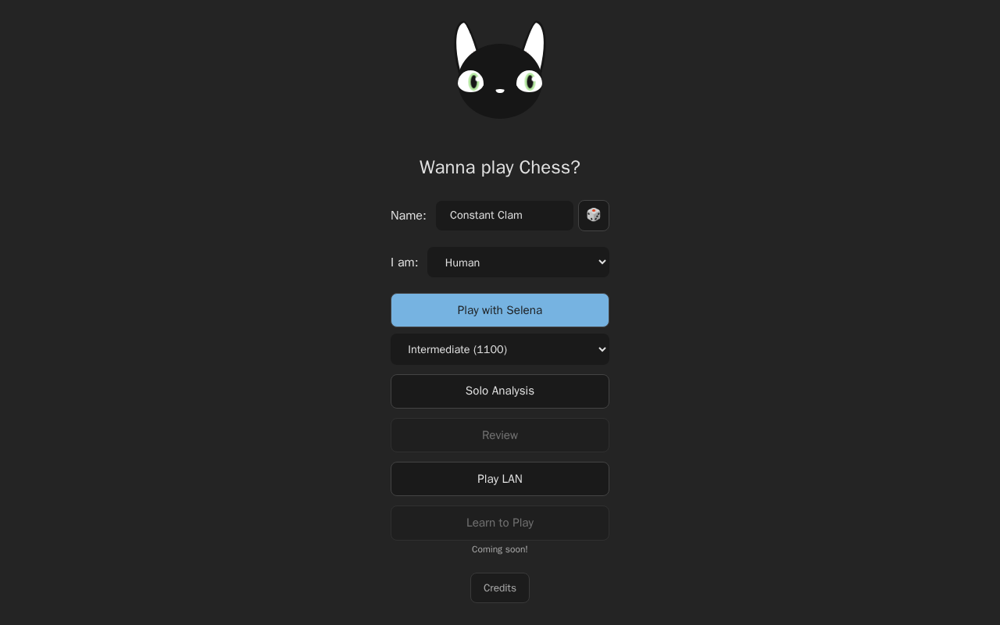

### CoachScreen — avatar in header · in-flow CoachPanel

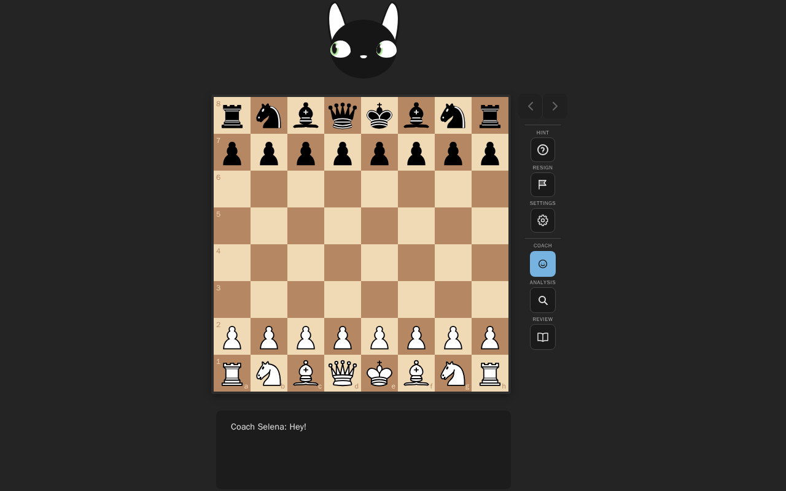

### AnalysisScreen — “Solo Analysis” + Back · FenLoader in SidebarInset

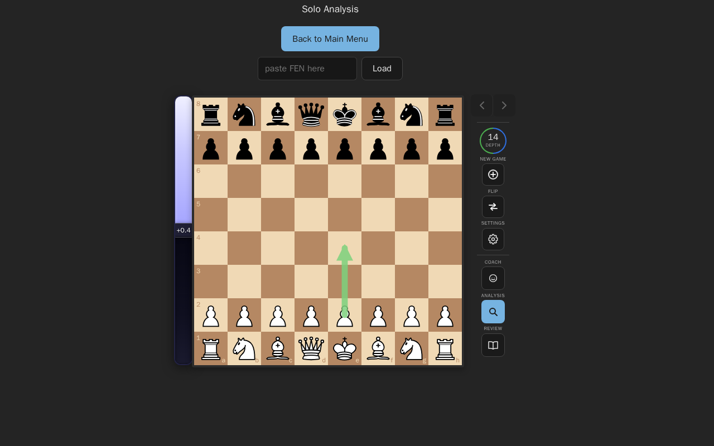

### ReviewScreen list (`/review`) — Playing as + First move grid · seeded GameHistoryList

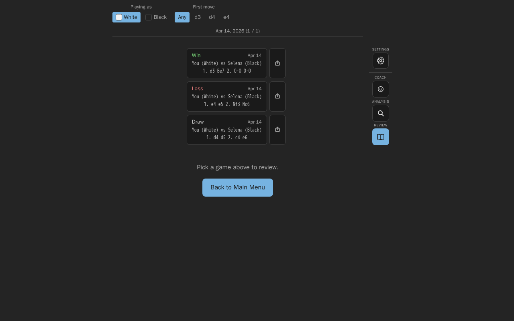

### ReviewScreen detail (`/review/:id`) — mid-game FEN · §4b floating MoveList (SAN + cp Δ + emotion) · Share then Back

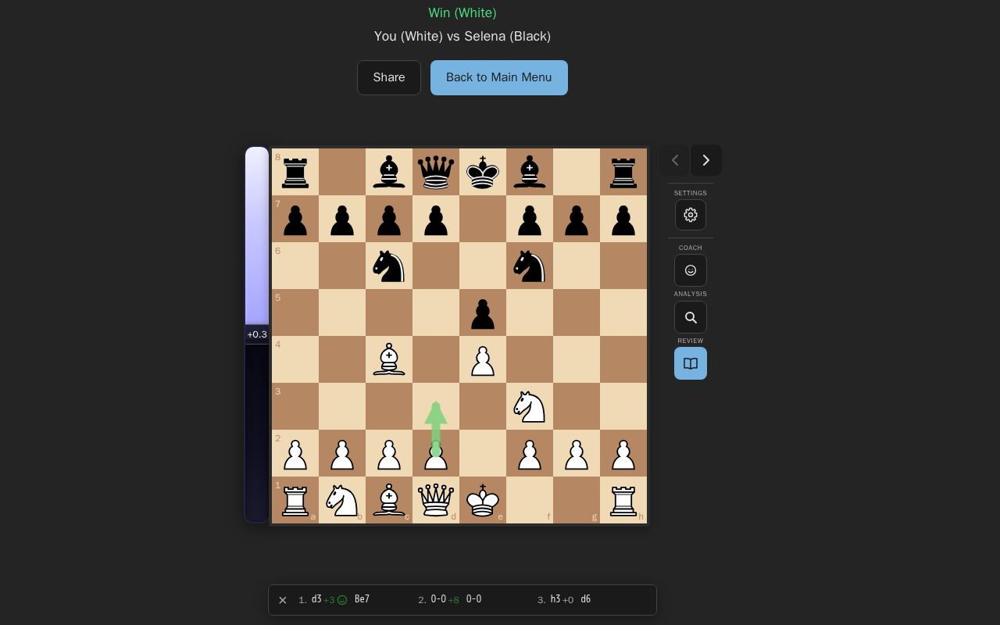

### LanScreen (lobby)

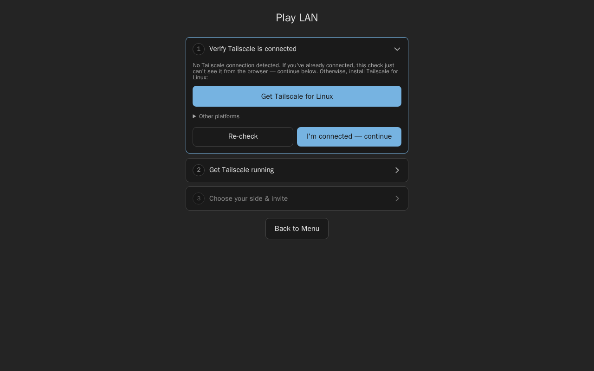

---

## 2. Mobile (390×844) — vertical spread + docked footers

Tall phone: top/bottom content-sized; middle is `1fr` with board-column `cqh` gaps
among chrome. §4 measures **board-column content** (not the stretched track) so
CoachPanel and MoveList **dock** when the footer budget fits.

### MenuScreen

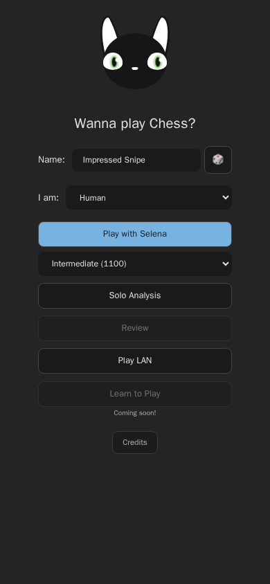

### CoachScreen — docked CoachPanel · hero avatar above tool bar · drawer top-left

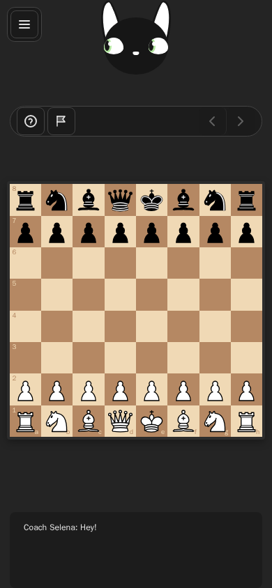

### AnalysisScreen — `[menu][Solo Analysis]` toolbar · FEN + Back · BoardControls (no drawer float)

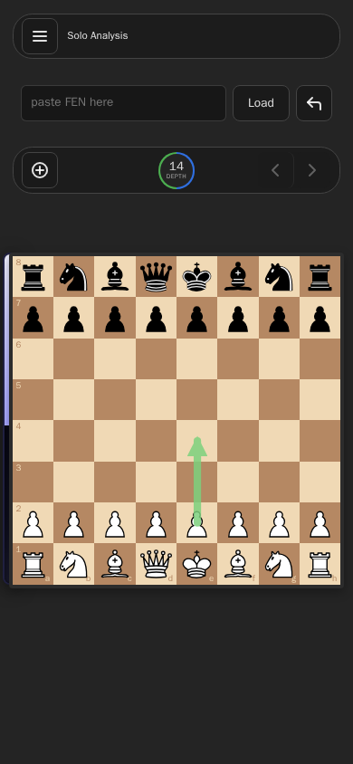

### ReviewScreen list (`/review`) — Playing as + First move grid · seeded GameHistoryList

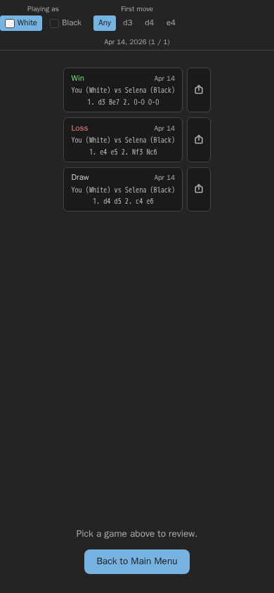

### ReviewScreen detail (`/review/:id`) — `[menu][matchup][Share · Back]` · EngineDepth in bar · docked MoveList (cp Δ on every player ply + emotion · up to 6 turns/page)

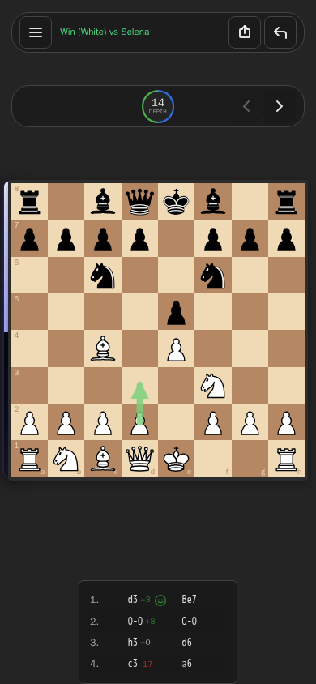

### LanScreen (lobby)

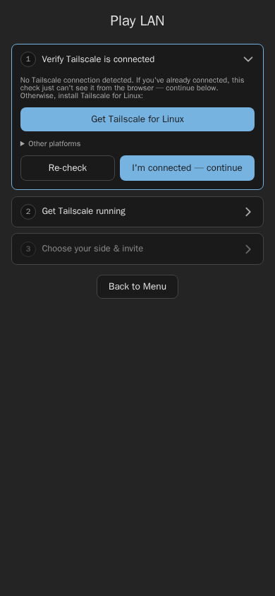

---

## 3. Dynamic (390×560)

Short viewport. Top chrome is **clumped** (tight gaps). In-flow footers that no
longer fit → §4 float on Coach / Review detail. Analysis drops the title row.

### CoachScreen — §4a floating advice · compact avatar + drawer in the bar

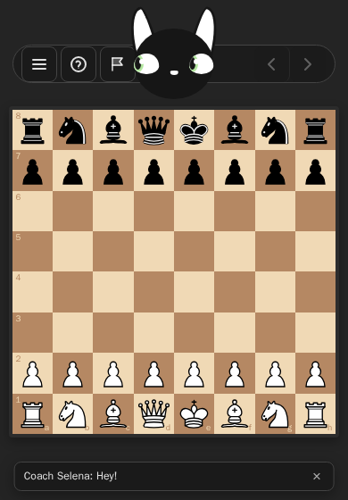

### AnalysisScreen — no title · FEN + Load + Back clumped · BoardControls (drawer in bar)

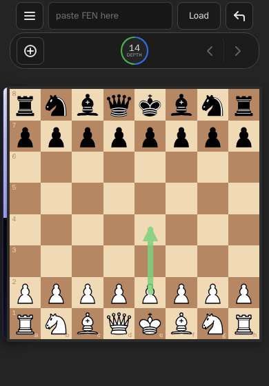

### ReviewScreen list (`/review`) — Playing as + First move grid at short height

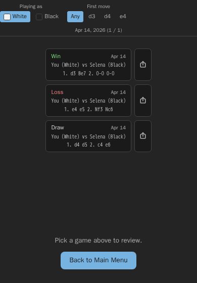

### ReviewScreen detail (`/review/:id`) — §4b floating move list (SAN + cp Δ + emotion) · `[menu][matchup][Share · Back]` · EngineDepth in bar

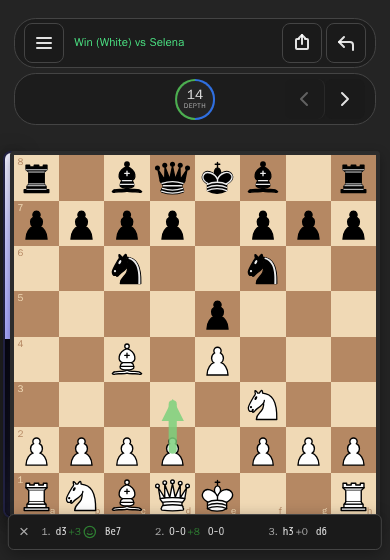

### MenuScreen

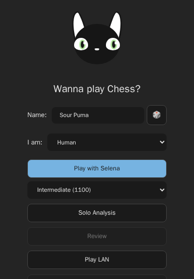

### LanScreen

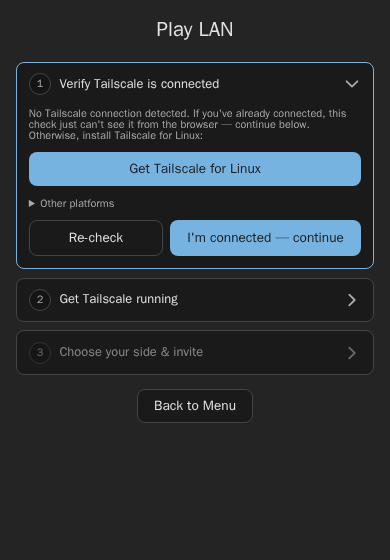

---

## Screen coverage matrix

| Screen | desktop | mobile | dynamic |
|---|---|---|---|
| `MenuScreen` | ✓ `*-menu` | ✓ | ✓ |
| `CoachScreen` | ✓ `*-coach` | ✓ hero + drawer TL · docked panel | ✓ §4a float · compact in bar |
| `AnalysisScreen` | ✓ `*-analysis` | ✓ `[menu][title]` · FEN+Back | ✓ no title · FEN+Back clumped |
| `ReviewScreen` list | ✓ `*-review-list` | ✓ `*-review-list` | ✓ `*-review-list` |
| `ReviewScreen` `/:id` | ✓ §4b float · Share\|Back | ✓ `[menu][matchup]` · docked | ✓ §4b float |
| `LanScreen` | ✓ `*-lan` | ✓ | ✓ |
