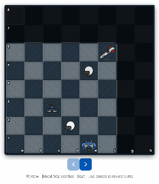
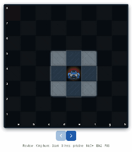

# Brood War FEN (BWFEN)

Sibling to [`BROODWAR_MODE.md`](BROODWAR_MODE.md). This doc is about **position encoding**: what classical FEN is good for, what Brood War must change, and the BW-only dialect (`BWFEN1`) that does not replace Coach/Analysis chess.

**Rules engine:** [`apps/ui/src/broodwar/`](src/broodwar/) (`board.ts`, `bwfen.ts`, future `resolveTurn.ts`).  
**Classic FEN:** one-way **render export** for [`ChessBoard`](src/components/features/ChessBoard.tsx) / `chess.js` `loadFen` — never the Brood War move oracle.

**Canonical turn shape:** [Combat Chain](http://localhost:6006/?path=/story/screens-nerd-demo--combat-chain) — one BWFEN `turn` = **White classical & Black classical**, then one shared placement. Read that story first; King Hunt reuses the same grammar with king HP.

| Demo | Story | Illustrates |
|---|---|---|
| **Combat Chain** (reference) | [screens-nerd-demo--combat-chain](http://localhost:6006/?path=/story/screens-nerd-demo--combat-chain) | `W & B` per turn; attack → death → occupy |
| King Hunt | [screens-nerd-demo--king-hunt](http://localhost:6006/?path=/story/screens-nerd-demo--king-hunt) | Same grammar + **checks** + **walk into check** (FEN-illegal, BWFEN-legal) |

```bash
node apps/ui/scripts/capture-broodwar-fen-gifs.cjs
```

---

## Turn shape (Combat Chain = how BWFEN looks)

Classical chess is **one SAN per ply**. Brood War is **two classical actions per resolve turn**, written like the Combat Chain captions:

```text
1. d2-d4 & Be8-c6
2. d4xe5 & Nf6-e4
3. Rc4xc6 & Ne4xc4
```

Each line is **one** BWFEN `turn` bump. After resolve you store **one** placement (both sides already moved) — not a white-to-move FEN waiting for Black.



| After | Placement (classic field 1) | BWFEN1 |
|---|---|---|
| Start | `4bk2/8/5n2/4p3/2R5/8/3P4/4K3` | `BWFEN1\|4bk2/8/5n2/4p3/2R5/8/3P4/4K3\|0\|33\|P` |
| `1. d2-d4 & Be8-c6` | `5k2/8/2b2n2/4p3/2RP4/8/8/4K3` | `BWFEN1\|…\|1\|33\|P` |
| `2. d4xe5 & Nf6-e4` | `5k2/8/2b5/4P3/2R1n3/8/8/4K3` | `BWFEN1\|…\|2\|33\|P` |
| `3. Rc4xc6 & Ne4xc4` | `5k2/8/8/4P3/2n5/8/8/4K3` | `BWFEN1\|…\|3\|33\|P` |

Quiet turn (`1`): both sides **slide** — one planning snap after both relocate.  
Capture turns (`2`–`3`): resolve splits **attack → move** (deaths first, survivors occupy). Mid-resolve you may emit `phase=A` then `phase=M` with an intermediate placement (e.g. victims gone, capturers still on `from`); planning `P` snaps above are **after** the full turn.

That table is the mental model for BWFEN. Lives stay `33` here — Combat Chain does not touch kings.

---

## Classical FEN (recap) — why it is not enough

```text
<placement> <side> <castling> <ep> <halfmove> <fullmove>
```

| Field | Classical role | Breaks in Brood War |
|---|---|---|
| **Placement** | Piece glyphs | Still used (shared) |
| **Side to move** | Exactly one side acts | **Both** already acted this turn — field is render-only |
| Castling / EP / clocks | Classical rules | Unused; BW extras live beside placement |

Assumptions wrong for BW: alternating plies, atomic captures, check filters legality, mate ends the game.

| Concern | Classical | Brood War |
|---|---|---|
| Who acts | One side / ply | **Both** queue; one shared resolve |
| Capture | One atomic move | **attack** then **move** if alive |
| Mutual captures | Impossible in one ply | Both may die → neither relocates |
| King | No walk into check | **3 HP**; may walk into fire; rubble at 0 HP |
| Extra state | Castling, EP | Lives, phase, economy, mines — **beside** placement |

Resolve order ([`BROODWAR_MODE.md`](BROODWAR_MODE.md) §9):

```text
specialBefore → attack → move → specialAfter
```

---

## BWFEN1 dialect

```text
BWFEN1|<placement>|<turn>|<wlives><blives>|<phase>[|U:<squares>]
```

| Field | Meaning |
|---|---|
| `placement` | Same 8-rank glyphs as classic FEN field 1 |
| `turn` | Resolve round index (`0` = start) — matches Combat Chain turn counter |
| `wlives` / `blives` | King HP `0–3` each |
| `phase` | `P` planning · `B` specialBefore · `A` attack · `M` move · `F` specialAfter · `O` gameover |
| `U:` (optional extras) | Packed squares whose unit already used a special this turn (e.g. `U:c4e4`). Cleared when `turn` advances. |

Combat Chain examples (above) are the **default** dialect picture. King Hunt only changes `wlives` when a king-shot connects.

API: [`src/broodwar/bwfen.ts`](src/broodwar/bwfen.ts). Geometry (no `.move()`): [`src/broodwar/board.ts`](src/broodwar/board.ts).

**v1 omits** queued dual plans inside the string (planning snaps only). Economy stays outside the string; spider mines and per-turn specials-used use `|extras` (`U:…` for specials). Never overload classic castling/EP.

---

## Same grammar + two extras: King Hunt

Combat Chain already shows BWFEN turn shape. King Hunt adds only:

1. **Checks** — occupancy puts the king in check (`Nc5+`, `Bg1+`, `Rf6+`); chrome stays; a connecting king-shot chips `wlives` (Option A).
2. **King walks into check** — `Kxc5` / `Kc6` onto a defended square. **Classic FEN-illegal** as a move; **BWFEN-legal** as a planning snap (placement + lives unchanged until a later shot).

Same `W & B` captions:

```text
0. … & Nc5+              → 3→2 (check shot)
1. Kd5 & Bh2→Bg1
2. Kxc5 (Bg1+) & Rf7→Rf6 → walk into check (no chip)
3. Kc6 & Bg1→c5          → 2→1 (check shot), flee into Rf6
4. … & Rf6+              → 1→0 rubble
```



Story: [screens-nerd-demo--king-hunt](http://localhost:6006/?path=/story/screens-nerd-demo--king-hunt)

| After | Notable placement | Lives |
|---|---|---|
| Start | `k7/5r2/8/2n5/4K3/8/7b/8` (rook **f7**, siege) | `33` |
| `0. … & Nc5+` | check shot (N revealed **during** attack VFX) | `23` |
| `1. Kd5 & Bh2→Bg1` | bishop **slides** to g1 | `23` |
| `2. Kxc5 & Rf7→Rf6` | walk into Bg1+; rook **slides** to f6 | `23` |
| `3. Kc6 & Bg1→c5` | check shot, then flee | `13` |
| `4. … & Rf6+` | check connects → rubble | `03` |

`wlives` is **engine state** (`broodWarStore.kingLives` / BWFEN lives field) — VFX only maps it. Fog punishment: enemies stay hidden until they shoot — `ChessBoard` reveals active `attackCues[].from` for the shot only. Quiet relocates use mover slides (Combat Chain), not FEN teleports.
---

## Classical-illegal → how BWFEN notes it

Rules catalog (authority): [`BROODWAR_MODE.md`](BROODWAR_MODE.md) § Classical / FEN-illegal scenarios.  
Encoding map below. Combat Chain covers simultaneous / attack→move. King Hunt only adds **checks** and **walk-into-check** (FEN-illegal move, BWFEN-legal snap).

### Checks + walk into check

| # | What | Classic FEN | BWFEN |
|---|---|---|---|
| 1 | Check (`Nc5+`, `Bg1+`, …) | Loadable; side-to-move / chrome | Same `placement`; shot may decrement `wlives` |
| 2 | King walks into check (`Kxc5`, `Kc6`) | **Illegal move** (`.move()` throws) | **Legal** planning snap — king on attacked square; lives unchanged until a later shot |

No `inFire` flag — derive check from placement + geometry.

### Locked scenarios → BWFEN fields

| Scenario (MODE catalog) | Noted in BWFEN how? | Not in the string |
|---|---|---|
| **Simultaneous both-sides classical** | Combat Chain: one `turn` + one post-resolve `placement` | Dual plans / SAN pair (v1 planning snaps only) |
| **Mutual captures both connect** | Combat Chain turn 3: both victims gone in placement | Mid-`A` before `M` unless you emit those phases |
| **Attack → move split** | Combat Chain turns 2–3 VFX; optional `phase` `A`/`M` snaps | Queued classical actions |
| **King walks into / stays in check** | `placement` (king on attacked square); lives unchanged until a later shot | No “inFire” flag |
| **King remains after hits (HP > 0)** | `wlives`/`blives` ∈ `1–3`; king glyph still in `placement` | — |
| **King-shot without occupying king square** | Same king square; lives decremented. Mid-shot: `phase=A` | Attacker’s queued `to` |
| **Damaged king keeps moving** | Later planning snaps: new king square + lives | Move history |

### King spawn (FEN-legal special)

| After resolve | BWFEN |
|---|---|
| Extra friendly piece adjacent to king | New glyph in `placement` only — **no dialect extension** |
| Economy spend / deploy caps | Outside BWFEN (store / `|extras` later) |

### Deferred specials (typed only — not loadable as “classic move then FEN”)

| Special | Placement / BWFEN note |
|---|---|
| **Pawn double anytime** | Resulting `placement` can look FEN-legal; *origin rank* rule is BW-only — string does not record that the step was illegal classically |
| **Bishop snipe** | Same — blockers ignored at resolve; snapshot may look like a normal diagonal capture/empty board |
| **Rook siege** | Damage without relocate → lives / removals in placement; rook square unchanged |
| **Queen warp** | Teleport → new queen square in `placement` (looks like any quiet move after the fact) |
| **Knight spider mine** | **Not** a placement piece — must be `|extras` (or side channel); never stuff into classic castling/EP |

Until those resolve: do not pretend BWFEN v1 distinguishes “got here via snipe” vs “ordinary path” — only the **engine** knows. Snapshots stay renderable; provenance is out of band.

### Render constraints (always)

| Constraint | BWFEN / classic export |
|---|---|
| **Both kings in every render FEN** | Even at `wlives=0` / rubble VFX, keep `K`/`k` in `placement` so `chess.js` `loadFen` works |
| **Check chrome** | Derived from occupancy; side-to-move in classic export often forced `"w"` when showing white-in-fire (demo convention) — not a BW rules field |
| **Mines / overlays** | Beside placement; never overload classic fields 3–4 |
| **Siege Tank mode** | Store / UI (`siegedRooks`); not yet a BWFEN extras field. King Hunt seeds **siege** on the black rook (starts f7). Combat Chain keeps **tank** mode with the white rook on **c4** (one closer). |

### Deferred — fog legality (not enforced yet)

**Attacking a unit that is under fog of war must be illegal** in Brood War planning / `resolveTurn`. The attacker needs vision on the target square (or the target must be revealed) before a classical attack can be queued or applied.

| Today | Later |
|---|---|
| Combat Chain / King Hunt / `resolveTurn` do **not** filter attacks by fog | Reject plans whose `to` is unseen by that side; optionally encode revealed-shot exceptions in `|extras` |
| BWFEN snaps stay geometry-only | Document any mid-shot reveal flags if needed |

Note this constraint here so BWFEN consumers do not assume “any geometrically clear capture is legal.” **Defer engine enforcement** until fog + plan validation land together.

---

## Classic FEN as render export only

| Do | Don’t |
|---|---|
| Emit classic FEN for `ChessBoard` (always **both kings** in placement) | Validate BW plans with `chess.js` `.move()` / check filters |
| Keep check / checkmate **chrome** from occupancy | Treat classical mate as a separate win path (use **0 HP rubble**) |
| Document divergences in [`BROODWAR_MODE.md`](BROODWAR_MODE.md) catalog | Invent a Coach-wide FEN fork |

```ts
import { classicFenFromBw, parseBwFen } from "~/broodwar/bwfen";
import { loadFen } from "~/store/gameStore";

loadFen(classicFenFromBw(parseBwFen(bw), "w"));
```

---

## Anti-goals

- Extending **classical** FEN for HP / mines / dual plans (breaks Coach/Analysis).
- Using `chess.js` as the Brood War rules board.
- Dropping classic placement export (Storybook, share, board UI still need it).

Full rules: [`BROODWAR_MODE.md`](BROODWAR_MODE.md).
