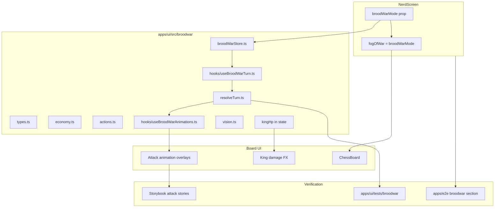
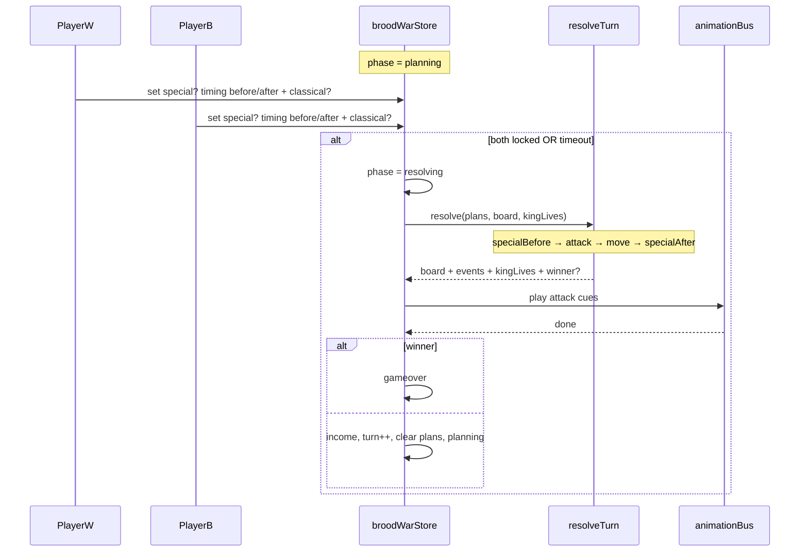
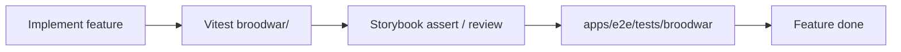

# Brood War Mode

Design and implementation plan for the Nerd / Brood War ruleset.
**Exclusive to** [`apps/ui/src/screens/NerdScreen.tsx`](apps/ui/src/screens/NerdScreen.tsx).
**All engine logic lives under** [`apps/ui/src/broodwar/`](apps/ui/src/broodwar/) — not for reuse outside this mode.

**Position encoding (classical FEN vs BWFEN, simultaneous attack→move, demo GIFs):** see sibling [`BROODWAR_FEN.md`](BROODWAR_FEN.md).

---

## Goals

Replace classical alternating chess turns with a simultaneous-action economy game:

| Concern | Classical chess | Brood War |
|---|---|---|
| Turn structure | One side moves | Both players queue plans; turn ends when both submit (or timeout) |
| Actions per turn | One move | **Stack:** ≤1 special + ≤1 classical; order sets timing; completing the stack (or End / timeout) submits |

| Conflicts | Impossible in one ply | Classical action resolves in **2 parts** (attack → move) |
| Economy | None | Stored + deployed material caps |
| Vision | Full board | Fog of war (**cumulative** vision of all own units) |
| Spawning | Fixed army | King special: spawn adjacent for cost |
| King | One checkmate; cannot walk into check | **3 lives**; check/mate replaced; **may walk into fire** (fog punishment) |

Fog of war and Brood War rules are both gated by `broodWarMode` on `NerdScreen`.

---

## Rules

These are locked for v1 so the engine can ship without further product decisions:

1. **Action budget (stack)** — each player may queue at most:
   - **1 special** action (spawn / ability), **and**
   - **1 classical** chess action (a single from→to).  
   Either slot may be empty. Actions **stack** in the order the player performs them:
   - **Special → classical** — special is timed `"before"`; after the classical action is queued, the plan **auto-submits**.
   - **Classical → special** — special is timed `"after"`; after the special is queued, the plan **auto-submits**.
   - **Special only / classical only / neither** — player presses **End** (or the timer expires) to submit.
2. **Special timing** — derived from stack order (above), not a separate toggle. Explicit `timing` on `QueuedSpecial` still stored for resolve. Default when only a special is End-submitted: `"before"`.
3. **Classical resolution (2 parts)** — every classical action is processed as:
   1. **Attack** — if the action is a capture/hit, apply damage / removals (mutual captures both connect; king hits decrement lives).
   2. **Move** — if the acting unit still lives and the destination is legal after attacks, relocate it.  
   Pure non-captures skip attack effects and only move. Motivating case: two pawns classical-capture each other → both die in attack → neither moves.
4. **Material income by turn number** (turn index starts at 1 after each resolved round):
   - turns `1–10` → **+1**
   - turns `11–20` → **+2**
   - turns `21+` → **+3**
5. **Vespene energy (special fuel)** — same tiers as material income (`1` / `2` / `3`). Refills to the tier cap at the start of each planning turn; **does not accumulate**. Each special costs **1** gas (exceptions: Bishop/Goliath Charon Booster Missiles and Queen/Battlecruiser Tactical Jump cost **2** — see Special moves). Shown on [`ResourceBar`](apps/ui/src/broodwar/primitives/ResourceBar.tsx) as remaining / capacity.
6. **Idle bonus** — if a player queues **neither** special nor classical → income × **1.5** (rounded down).
7. **Caps** — max **12** stored material; max **50** deployed material (King counts as **1** deployed). UI deploy count on ResourceBar is **Σ unit costs** of pieces the player owns on the board.
8. **Unit purchase costs** (stored → deployed on spawn):

   | Unit | Cost |
   |---|---|
   | King | 1 (starting; not purchasable) |
   | Pawn | 1 |
   | Knight | 3 |
   | Bishop | 3 |
   | Rook | 5 |
   | Queen | 9 |

9. **Turn timeout** — **10s** constant (`TURN_TIMEOUT_MS`). Shown on [`TurnBar`](apps/ui/src/broodwar/primitives/TurnBar.tsx) as a circular gauge with seconds in the center. Expiry auto-submits the current plan (same as End).
10. **Global phase order** — `[specialBefore | attack | move | specialAfter]`:
   - **specialBefore** — specials with `timing: "before"` (e.g. king spawn)
   - **attack** — classical part 1 (both players)
   - **move** — classical part 2 (both players)
   - **specialAfter** — specials with `timing: "after"`
11. **King lives** — each king starts at **3 HP**. A successful **attack** that targets the enemy king decrements HP by 1 (king stays on board until HP = 0). Third hit → destroyed → that player loses. Visual states: [King damage states](#king-damage-states). Classical check / checkmate / stalemate / insufficient-material **draws are not Brood War outcomes** (HP replaces mate; no DRAW banner).
12. **King hits vs classical check (attack timing)** — locked Option A: arrival / discovered threats are **next turn**. Same phase clock as every other unit — **no** “king-target resolves after move” exception.
    1. A successful king hit = classical attack with `to === enemyKingSquare`, clear geometry from the attacker’s **pre-move** square, during the **attack** phase.
    2. Relocating onto (or uncovering) a ray that attacks the king does **not** chip HP this resolve — that only enables a king-shot on a **later** turn’s attack phase.
    3. Non-king pieces never occupy the enemy king’s square; damage is HP only. Kings may still capture other units with attack → occupy (e.g. `Kxc5`).
    4. Classical `+` / checkmate annotations are not Brood War results. UI **may** show a post-`move` **threatened** telegraph (preview of next-turn shots) without applying damage.
    5. **Caveat — king may walk into fire.** Moving or staying on a square attacked by the enemy is **legal** in Brood War (classically illegal as moving into / remaining in check). This is the fog-of-war punishment: without vision you can step onto a hidden shooter. Option A still applies — the standing shooter chips HP only when they queue a king-shot on a later attack phase (or this phase if they already stood on a clear ray and targeted the king).
13. **Attack animations (v1)** — one attack VFX per unit type ([Attack animations](#attack-animations-v1)); verified in Storybook. Move/special VFX deferred.
14. **Special abilities** — long-press a friendly unit to queue that unit’s special (uses the **1 special** slot; burns **1** vespene). See [Special moves](#special-moves).
15. **Board chrome** — Brood War has **no captured-pieces rows**. **`ResourceBar` + `TurnBar` sit side-by-side above the board** (minerals / vespene / deploy | End + 10s gauge). Specials are armed by **dragging a footer gas canister** onto a unit ([`GasDeploy`](apps/ui/src/broodwar/features/GasDeploy.tsx) story); long-press demos remain until live wiring.

---

## Special moves

Triggered by **long-press** on a friendly piece during planning (not a tap/select). Queues into `PlayerTurnPlan.special`. Timing comes from [action stack order](#rules) (special-first → `"before"`; move-first → `"after"`). Still ≤1 special per player per turn.

| Unit | Special | Notes | FEN / `chess.js` |
|---|---|---|---|
| **Pawn (Marine)** | Extra step | Start-rank classical doubles remain free. Paid gas special moves only **1 extra square** forward (destination empty; no d2→d6 stacking). | Classical double FEN-legal; gas extra step is a Brood War board op |
| **Knight** | Drop spider mine | Place a landmine on a legal adjacent/empty target (product TBD). **Once per knight** (track `minesUsed` / unit id). | Mine is not a chess piece — deferred board model |
| **Bishop (Goliath)** | Charon Booster Missiles (internal `bishopSnipe`) | Costs **2** vespene. Two-canister GasDeploy drag arms targeting only (energy < 2 → “Not enough gas (2 required)”); exactly one enemy queen on the diagonal rays (blockers ignored) is highlighted; wrong clicks are ignored while armed; clicking the queen fires twin homing missiles (`bishopCharon`, 250ms). Bishop does **not** relocate; queen is removed on impact + normal death/FEN commit. | **Illegal** (ignores blockers) — **implemented** via Brood War board ops |
| **Rook** | Attack without moving | Classical-style attack/capture VFX + damage on a rook-legal target square, but the rook **stays** on `from`. | **Illegal** — deferred |
| **Queen (Battlecruiser)** | Tactical Jump (internal `queenWarp`) | Costs **2** vespene. Two-canister GasDeploy drag arms targeting; click a highlighted **visible empty** square (blockers ignored) to teleport. Attacks on the jumping queen are ignored. VFX: 200ms stretched-thin light travel facing the jump, 50ms appear burst, green back thrusters, twin trails fading over 1000ms. | **Illegal** (teleport / ignore path) — **implemented** via Brood War board ops |
| **King** | Spawn (purchase) | Opens a [`PromotionModal`](apps/ui/src/components/primitives/PromotionModal.tsx) **variant** (spawn picker), not pawn promotion. Spends stored material; deploys adjacent (spawn rules already in economy). | FEN-legal once spawned (position stays FEN-loadable) |

### Classical / FEN-illegal scenarios (catalog)

Brood War must **not** filter plans through `chess.js` check / mate legality. Most rows below are classically illegal; **king spawn is the exception** — see the subsection after the locked table.

#### Locked — allow in `resolveTurn` / `actions` (do not reject as “in check”)

| Scenario | Why classical / FEN rejects it | Brood War |
|---|---|---|
| **King walks into (or stays in) a line of fire** | Moving into check / leaving the king in check | **Allowed** — fog punishment for missing vision ([rule §11.5](#rules)). Shooters still need an attack-phase king-shot to chip HP (Option A). |
| **King remains after hits (HP > 0)** | Capturing the king / checkmate ends the game | King stays on the board until HP = 0; third hit wins ([rule §10](#rules)). |
| **King-shot without occupying the king square** | Capture removes the king | Non-king attackers never step onto the enemy king; damage is HP only ([rule §11.3](#rules)). |
| **Damaged king keeps moving** | Game already over after mate / king capture | While HP > 0 the king may flee, capture, or walk into further fire. |
| **Simultaneous both-sides classical actions** | One side moves per ply | Both plans resolve in one turn (`attack` then `move` for both). |
| **Mutual classical captures both connect** | Only one capture resolves per ply | e.g. opposing pawns capture each other → both die in `attack` → neither moves ([rule §3](#rules)). |
| **Attack → move split (dead units skip relocate)** | A capture is a single atomic move | Part 1 applies damage/removals; part 2 relocates only survivors ([rule §3](#rules) / §9). |

#### King spawn — FEN-legal special (not classical-illegal)

The king’s special is **purchase + deploy an adjacent unit** (`p` / `n` / `b` / `r` / `q`). It is **not** a `chess.js` SAN move (no classical ply adds a piece from the economy), but the **resulting board is ordinary FEN** — an extra friendly piece on an empty adjacent square, both kings still present.

| Concern | Rule |
|---|---|
| Who | Long-press **friendly king** → spawn modal (not pawn promotion). |
| Where | Empty square **adjacent** to the king (validation in `actions.ts`). |
| Cost | Spend **stored** material per unit cost table; increment **deployed** (respect caps). |
| Phase | Special with stack timing `"before"` / `"after"` like other specials ([rule §1](#rules) / §9). |
| FEN | **Legal** after resolve — ship this special first; do **not** lump it with deferred FEN-illegal specials. |
| vs illegal specials | Rook attack-without-moving / mines break or bypass piece-placement FEN; spawn does not. Marine gas extra step, Bishop Charon Booster Missiles, and Queen Tactical Jump bypass classical limits but ship via Brood War board ops. |

#### Remaining deferred specials / board-model gaps

Do **not** implement resolution for these until Brood War board ops exist (not “classical move then FEN”):

| Special | Classical / FEN issue |
|---|---|
| **Rook siege** | Attack/damage without relocating |
| **Knight spider mine** | Mine is not a FEN piece; occupancy / vision / trigger TBD |

Until then: keep `SpecialKind` stubs; long-press UI may show “coming soon” / disabled; **ship first** king spawn + `ResourceBar` + economy validation.

#### Render / snapshot constraints (still FEN-loadable)

| Constraint | Why |
|---|---|
| **Both kings present in every render FEN** | `chess.js` rejects kingless FENs — even after HP = 0 / rubble VFX, keep a loadable snapshot (Storybook + live board). |
| **Mines / non-piece overlays** | Not encoded in FEN piece placement; track beside the board snapshot when mines ship. |

Capture / classical combat rendering continues to use FEN-loadable snapshots. Full catalog of divergences lives here; do not reintroduce classical check filters when wiring `actions.ts` / `resolveTurn.ts`.

### King spawn modal + ResourceBar

Long-press king → modal variant of `PromotionModal`:

1. **Top: `ResourceBar`** ([`broodwar/primitives/ResourceBar`](apps/ui/src/broodwar/primitives/ResourceBar.tsx))
   - **Minerals strip:** blocks icon + `{stored}` + `+{incomePerTurn}` (income is the *next* turn’s base income from [rules §4](#rules), not idle bonus).
   - **Vespene strip:** canister icon + `{remaining} / {capacity}` this turn ([rules §5](#rules)).
   - **Deployed strip:** blocks+people icon + `{boardDeployed} / 50` (Σ `UNIT_COST` of owned pieces; `MAX_DEPLOYED_MATERIAL`).
2. **Below: spawn choices** — **pawn first**, then the usual promotional set: `p`, `q`, `r`, `b`, `n` (order: pawn → queen → rook → bishop → knight). Disable / grey choices the player cannot afford (minerals, deploy cap, or **no vespene**).
3. On select: queue `QueuedSpecial { kind: "spawn", unit, from: kingSq, to: spawnSq, … }`. Exact adjacent-target UX (auto-pick vs second tap on empty adjacent square) — implement with spawn validation in `actions.ts`.

Classical pawn-promotion `PromotionModal` stays unchanged for Coach/Analysis; Brood War uses an explicit variant prop or a thin `DeployModal` wrapper that reuses modal chrome + choice grid.

---
## Architecture



**Do not** put Brood War turn resolution into `gameStore` / `useMoveExecutor`. Classical chess remains FEN + `chess.js` for Coach/Analysis/LAN. Brood War owns its own board snapshot + turn plans.

**FEN-compatible boards:** every Brood War position that renders on `ChessBoard` must be a valid FEN (including both kings). `chess.js` rejects kingless FENs, so Storybook seeds, fog demos, and live Brood War snapshots stay FEN-loadable even when rules diverge from classical chess. Divergences (king into fire, HP, mutual captures, deferred specials, …) are cataloged under [Classical / FEN-illegal scenarios](#classical--fen-illegal-scenarios-catalog) — never reintroduce classical check filters in `actions` / `resolveTurn`. Full BWFEN dialect + demo GIFs: [`BROODWAR_FEN.md`](BROODWAR_FEN.md).

---

## Package layout

```
apps/ui/src/broodwar/
  index.ts
  types.ts
  constants.ts             # caps, costs, timeout, income, KING_MAX_LIVES=3
  economy.ts               # (todo) income, afford, deploy cap
  actions.ts               # (todo) ≤1 special + ≤1 classical; special timing; spawn
  board.ts                 # (todo)
  resolveTurn.ts           # (todo) specialBefore → attack → move → specialAfter
  vision.ts                # done — cumulative getSideVision
  broodWarStore.ts         # (todo)
  hooks/
    useBroodWarGame.ts     # (todo)
    useBroodWarTurn.ts     # (todo)
    useBroodWarAnimations.ts  # done — attack/death bus + playCaptured
  specials/                # (todo) long-press handlers; deferred FEN-illegal stubs
  animations/              # done — AttackAnimation, DeathAnimation, cues, Storybook harnesses
    …

apps/ui/src/broodwar/primitives/
  icons.tsx                # MineralsIcon | VespeneIcon | SupplyIcon
  ResourceBar.tsx          # minerals + income | vespene remaining/cap | board deploy/50
  TurnBar.tsx              # End + circular 10s gauge (beside ResourceBar above board)
  DeployModal.tsx          # king special — ResourceBar + pawn-first choices
  SpecialPreview.tsx       # hover chat card (unit / special / description)
  specialCopy.ts           # knight/king copy + TBD stubs

apps/ui/src/broodwar/features/
  GasDeploy.tsx            # footer gas rack — drag canister onto unit (store-backed)

apps/ui/src/components/primitives/
  PromotionModal.tsx       # classical promote (unchanged)

apps/ui/src/screens/
  NerdAttackAnimations.stories.tsx   # Screens/Nerd/Brood War/Attack Animations
  NerdDeathAnimations.stories.tsx    # Screens/Nerd/Brood War/Death Animations

apps/ui/tests/broodwar/
  economy.test.ts
  actions.test.ts
  resolveTurn.test.ts
  kingLives.test.ts
  vision.test.ts             # done (also via utils re-export)

apps/e2e/
  tests/broodwar/
    turn-rules.spec.ts
    king-lives.spec.ts
    material-income.spec.ts
    fog-of-war.spec.ts
    spawn-king-special.spec.ts
```

---

## Core types

```ts
type BroodWarColor = "w" | "b";
type TurnPhase = "specialBefore" | "attack" | "move" | "specialAfter";
type SpecialTiming = "before" | "after";

/** Per-unit special (long-press). `spawn` = king only for v1 implementable path. */
type SpecialKind =
  | "spawn"           // king — purchase adjacent unit
  | "pawnDouble"      // Marine steps — classical double free; gas extra step (+1) shipped
  | "knightMine"      // deferred — once per knight; mine board model TBD
  | "bishopSnipe"     // Charon Booster Missiles — shipped (2 gas; ignore blockers)
  | "rookSiege"       // deferred — attack without moving
  | "queenWarp";      // Tactical Jump — shipped (2 gas; teleport to visible empty square)

type KingDamageState = "pristine" | "smallFire" | "bigFire" | "destroyed";
// lives 3 → pristine, 2 → smallFire, 1 → bigFire, 0 → destroyed

/** At most one special per player per turn. */
type QueuedSpecial = {
  id: string;
  color: BroodWarColor;
  kind: SpecialKind;
  timing: SpecialTiming;
  from?: Square;       // acting unit (king for spawn; piece for abilities)
  to: Square;          // spawn tile / ability target
  unit?: PieceSymbol;  // spawn type (pawn..queen)
};

/**
 * At most one classical chess action per player per turn.
 * Resolved in two parts: attack (if capturing) then move (if unit still alive).
 */
type QueuedClassical = {
  id: string;
  color: BroodWarColor;
  from: Square;
  to: Square;
};

type PlayerTurnPlan = {
  special: QueuedSpecial | null;
  classical: QueuedClassical | null;
};

type PlayerEconomy = {
  stored: number;    // 0..12
  deployed: number;  // 0..50 (king = 1)
};

type BroodWarState = {
  turn: number;
  board: BroodWarBoard;
  economies: Record<BroodWarColor, PlayerEconomy>;
  kingLives: Record<BroodWarColor, number>; // 0..3
  plans: Record<BroodWarColor, PlayerTurnPlan>;
  locked: Record<BroodWarColor, boolean>;
  phase: TurnPhase | "planning" | "resolving" | "gameover";
  winner: BroodWarColor | null;
  turnDeadline: number | null;
  lastResolveEvents: ResolveEvent[];
};

type AttackAnimKind =
  | "pawnRifle"
  | "knightFrag"
  | "bishopGatlings"
  | "rookBattery"
  | "queenLaser"
  | "kingDualCannon";
```

---

## King damage states

| Lives | State | Presentation |
|---|---|---|
| 3 | `pristine` | Default king art |
| 2 | `smallFire` | Small fire animations over the king |
| 1 | `bigFire` | Large fire animations over the king |
| 0 | `destroyed` | Destroyed art; game over for that side |

**Hit rule:** during the **attack** half of classical resolution, each successful hit on a living enemy king decrements lives by 1. At 0 → destroyed → opponent wins.

**King attack animation** (king as attacker): hat flips → dual cannon battery (`kingDualCannon`). Independent of victim damage FX.

---

## Attack animations (v1)

Only **attack** animations ship in v1 (classical part 1). Cues from `ResolveEvent` with `phase: "attack"`:

| Unit | Animation |
|---|---|
| Pawn | Rifle fires (barrel light + cast shadow on pawn body) |
| Knight | Throws a frag grenade |
| Bishop | Attacks with the two gatling guns |
| Rook | Fires from the main tank battery |
| Queen | Fires a thick laser shot |
| King | Hat flips; dual cannon battery revealed and fires |

DOM hooks: `data-attack-anim="pawnRifle"` (etc.) for Storybook / Playwright.

---

## Turn lifecycle



### Planning

- Edit `PlayerTurnPlan` by stacking actions (special and/or classical) until auto-submit, **End**, or timeout.
- Validation (`actions.ts`): ≤1 special, ≤1 classical; spawn adjacent + afford + deploy cap; classical must be a legal unit move/capture from current board.
- Timing is implied by stack order (special→move = before; move→special = after).

### Board chrome (replaces captures)

On `NerdScreen` when `broodWarMode`: **no** `OpponentCaptures` / `PlayerCaptures`. One row above the board:

| Side | Brood War |
|---|---|
| Left (flex) | [`ResourceBar`](apps/ui/src/broodwar/primitives/ResourceBar.tsx) — minerals, vespene, board-derived deploy |
| Right | [`TurnBar`](apps/ui/src/broodwar/primitives/TurnBar.tsx) — **End** + circular seconds gauge (`TURN_TIMEOUT_MS` = 10s) |

### Resolution order

Deterministic within each phase: white then black (then by `id` if needed).

1. **specialBefore** — specials with `timing: "before"` (king spawn, etc.).
2. **attack** — for each classical action that targets an occupied enemy square (or king hit): two-pass mark → apply. Mutual classical captures both succeed. King targets decrement `kingLives` only when `to === enemyKingSquare` with clear pre-move geometry ([rule §11](#rules)). Uncovering / arriving on a king ray does **not** chip HP here.
3. **move** — for each classical action whose `from` unit still lives: move to `to` if empty / allowed after attacks. Capturing units that already removed the target and survive step onto `to`. Non-king pieces never step onto the enemy king’s square (HP damage only).
4. **specialAfter** — specials with `timing: "after"`.

Example — mutual pawn captures, no specials:

| Phase | Result |
|---|---|
| specialBefore | — |
| attack | Both pawns marked dead / removed |
| move | Both classical moves skipped (units gone) |
| specialAfter | — |

Example — white special spawn before, black special after, both classical non-captures:

| Phase | Result |
|---|---|
| specialBefore | White spawn resolves |
| attack | no-op |
| move | Both pieces relocate |
| specialAfter | Black special resolves |

### Income (after resolution, if no winner)

```ts
base = turn <= 10 ? 1 : turn <= 20 ? 2 : 3
idle = plan.special == null && plan.classical == null
gain = idle ? floor(base * 1.5) : base
stored = min(12, stored + gain)
```

---

## Fog of war gate

**Non-negotiable:** Brood War / Nerd gameplay **always** has cumulative fog of war. There is no `fogOfWar={false}` escape hatch while `broodWarMode` is on.

- `broodWarMode?: boolean` on `NerdScreen` (default `true` on `/broodwar`).
- `fogOfWar = broodWarMode` — when mode is on, fog is forced on.
- Maps / terrain gallery (`Screens/Nerd/Brood War/Maps`) sets `broodWarMode: false` so board skins can be previewed without fog (not gameplay).
- Vision lives in [`broodwar/vision.ts`](apps/ui/src/broodwar/vision.ts) (re-export from [`utils/nerdVision.ts`](apps/ui/src/utils/nerdVision.ts)).

### Cumulative vision (not selected-unit)

Fog is cleared by the **union of vision from every friendly unit still on the board** for the viewing side. Selecting a unit does **not** switch the fog mask.

- `getUnitVision(board, square)` — per-piece geometry (unchanged rules: king 3×3, pawn wedge, knight truncated 5×5, bishop 5×5 + queen ping, rook/queen 7×7).
- `getSideVision(board, color)` — unions `litSquares` / `revealedPieces` across all pieces of `color`.
- Board rendering always uses `getSideVision` for the local player (e.g. white on Nerd demos).
- Empty army ⇒ full fog (no lit tiles). Own pieces remain visible through fog as today; enemies stay hidden unless on a lit tile or in `revealedPieces` (bishop queen-ping still contributes when any friendly bishop sees them).
- **Attack-time reveal:** while an `attackCue` is active, `ChessBoard` adds that cue’s `from` to `revealedPieces` so a shooter under fog appears for the shot only (fog punishment until they fire).
- **Fog = player info only.** The engine always resolves both sides’ plans; quiet enemy relocates under fog still happen — they just get **no mover VFX** for the local player (`isPieceVisibleToSide`).

**Migration:** drop `visionSource` / `initialVisionSquare` as the fog driver. Storybook fog stories seed positions via FEN only; the mask updates whenever the board (or side) changes. Optional selection highlight may remain for UI, but it must not scope fog.

Per-piece vision rules themselves are unchanged; only the aggregation model changes.

---

## Screen wiring

```tsx
if (props.broodWarMode ?? true) {
  useBroodWarGame({ startingFen: props.startingFen ?? NERD_STARTING_FEN });
} else {
  loadFen(props.startingFen ?? NERD_STARTING_FEN);
}

<ChessBoard
  fogOfWar // always when broodWarMode — not optional
  kingDamage={broodWarMode ? kingDamageStates() : undefined}
  attackCue={broodWarMode ? currentAttackCue() : undefined}
/>
```

UI chrome (v1): `ResourceBar` + `TurnBar` side-by-side above the board (no captured pieces); fog always on; long-press → special ([Special moves](#special-moves)).

---

## Verification loops

Every feature: **unit → Storybook (visual) → e2e**. Done only when the loop passes.



### 1. Unit / integration (`apps/ui/tests/broodwar/`)

| Feature | Tests |
|---|---|
| Economy | Income tiers, idle 1.5× (no special + no classical), caps, costs |
| Vision | `getSideVision` unions all friendly units; not selection-based; per-unit geometry still covered |
| Actions | Reject 2nd special / 2nd classical; timing required; spawn rules |
| resolveTurn | specialBefore vs specialAfter ordering; mutual classical pawn captures both die; move skipped if dead; king HP |
| King lives | 3→2→1→0 + winner |

### 2. Storybook (animations + king damage)

**Title:** `Screens/Nerd/Brood War/Attack Animations`

| Story | Asserts |
|---|---|
| `PawnRifle` … `KingDualCannon` | Per-unit `data-attack-anim` hooks |
| `KingDamagePristine` … `Destroyed` | `data-king-damage` for all four states |

Play functions fire one cue and assert DOM. Visual review required for animation PRs.

### 3. E2E (`apps/e2e/tests/broodwar/`)

| Spec | Verification loop |
|---|---|
| **`turn-rules.spec.ts`** | Canonical turn: one special (before) + classical captures that mutually destroy; assert phase order, both pawns dead, income, turn++, plans cleared; also cover special-after ordering |
| **`king-lives.spec.ts`** | Three king hits → damage states → winner |
| **`material-income.spec.ts`** | Idle bonus + tier boundaries + cap 12 |
| **`fog-of-war.spec.ts`** | Mode on/off; cumulative vision grows/shrinks with army (multi-unit FEN lit set = union, not single piece) |
| **`spawn-king-special.spec.ts`** | Spawn as the single special (before/after), cost/cap/adjacency |
| **`attack-anims.spec.ts`** (optional thin) | Smoke `data-attack-anim`; detail in Storybook |

### Definition of done (per feature)

1. Pure tests green under `apps/ui/tests/broodwar/`.
2. Pixels (attack anim, king fire): Storybook story + play assertion green.
3. Turn/economy/HP rules: matching `apps/e2e/tests/broodwar/*.spec.ts` green.
4. `broodWarMode` gate covered.

---

## Implementation order

1. ~~Scaffold `broodwar/` — types, constants, vision, animations~~ **done**
2. Economy + actions — spawn validation; special kind stubs (deferred kinds rejected or no-op)
3. **King spawn UI** — `ResourceBar` + PromotionModal variant; long-press king
4. `resolveTurn` — `specialBefore → attack → move → specialAfter`; mutual captures; king HP; **spawn only** among specials
5. `broodWarStore` + hooks — planning → resolve → anim (`playCaptured`) → income / gameover
6. Long-press board affordance; disable deferred specials in UI
7. King damage FX Storybook; e2e broodwar section
8. Later — FEN-illegal specials (pawn/bishop/rook/queen) + knight mines

---

## What stays outside `broodwar/`

- ChessBoard shell, terrain CSS, piece sets
- `NERD_CAPABILITIES`, unlock / identity
- Classical `gameStore` / `useMoveExecutor`
- Storybook/e2e runners

---

## Non-goals (v1)

- Networked multiplayer / LAN for Brood War
- Move / special animation art (attack-only VFX; death cues ship for captures)
- Multiple specials or multiple classical actions per turn
- Persisting Brood War matches to `gameHistoryStore`
- Replacing Coach/Analysis chess engine
- Resolving remaining FEN-illegal rook attack-without-moving — typed only
- Full spider-mine simulation (placement UX + trigger rules TBD)

---

## Roadmap

### Done

**Cumulative fog of war (`getSideVision`)** — 2026-07-26

- [`broodwar/vision.ts`](apps/ui/src/broodwar/vision.ts) (re-export from [`utils/nerdVision.ts`](apps/ui/src/utils/nerdVision.ts)): unions vision across every friendly unit.
- [`ChessBoard`](apps/ui/src/components/features/ChessBoard.tsx) fog via `getSideVision`; fog stories FEN-seeded.

**`broodwar/` animation package + ChessBoard cues** — 2026-07-27

- Scaffold: [`types.ts`](apps/ui/src/broodwar/types.ts), [`constants.ts`](apps/ui/src/broodwar/constants.ts), [`vision.ts`](apps/ui/src/broodwar/vision.ts).
- [`AttackAnimation`](apps/ui/src/broodwar/animations/AttackAnimation.tsx) / [`DeathAnimation`](apps/ui/src/broodwar/animations/DeathAnimation.tsx); per-unit attack kinds; inline + death SVG pieces.
- [`useBroodWarAnimations`](apps/ui/src/broodwar/hooks/useBroodWarAnimations.ts): `playAttack`, **`playCaptured` / `playDeath`**, `interruptAttack` (capture → death layer; mid-attack hull clears).
- ChessBoard props: `attackCue(s)`, `attackDying`, `deathCues`, `kingDamage` (API ready).
- Storybook: `Screens/Nerd/Brood War/Attack Animations`, `…/Death Animations` (harnesses drive ChessBoard cues); Combat Chain demo uses capture→death.
- Classical assets untouched: [`public/pieces/nerd/`](apps/ui/public/pieces/nerd/).

### Notes — turn chrome + action stack (2026-07-27)

- Action stack: special→move or move→special auto-submits; End / 10s timeout submits partial/empty plans.
- `NerdScreen` chrome: **ResourceBar** + **TurnBar** side-by-side above the board (no captured pieces) when `broodWarMode`.
- Timing toggle removed from UI — order of actions sets `before` / `after`.

### Next

1. Economy + `actions` validation (spawn cost/cap/adjacency); `QueuedSpecial` kinds including deferred stubs.
2. **King spawn:** `ResourceBar` + spawn modal variant; long-press king → queue spawn special.
3. Long-press affordance on board (other units: disabled / “soon” for deferred kinds).
4. `resolveTurn` + `broodWarStore` (classical attack→move + king spawn only for specials).
5. `broodWarMode` gate polish on `NerdScreen`; king damage FX Storybook.
6. `apps/e2e/tests/broodwar/` (`turn-rules`, `king-lives`, `spawn-king-special`, …).
7. Later: FEN-illegal specials behind Brood War board ops (not `chess.js` moves).
